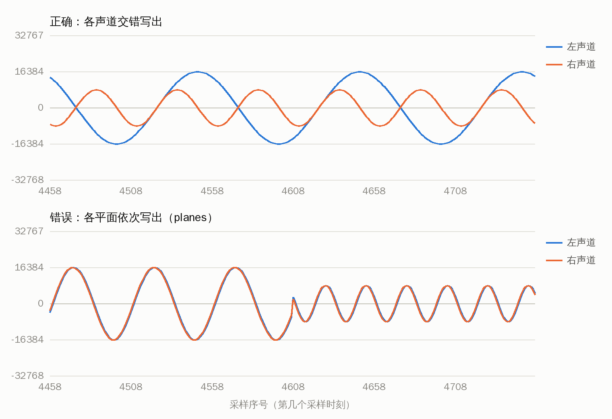
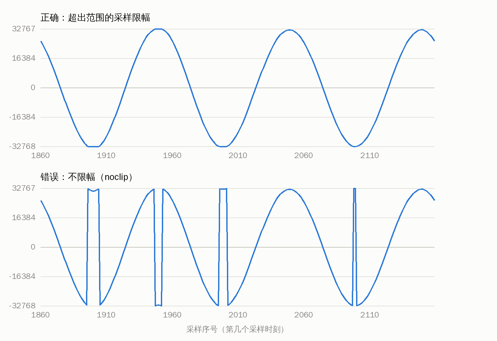

# L06 音频解码

上一讲把压缩的视频还原成了图像，这一讲把压缩的音频还原成声音的原始数据：PCM。
解码的写法和上一讲完全一样，还是 `avcodec_send_packet()` 送包、`avcodec_receive_frame()` 取帧，音频和视频用的是同一套接口。
新东西都在解码出来的 `AVFrame` 里：采样格式、planar 和 packed 两种排列、声道布局、一帧里有多少个采样。

和上一讲一样，为了把解码单独拿出来讲，这一讲不用 libavformat，直接读裸流。

完成标志：`decode_wav` 写出的 WAV 文件用普通播放器能播放，里面的数据与 ffmpeg 命令行解码的结果逐字节相同；
能说清楚 s16、s16p、fltp 分别是什么，`nb_samples` 数的是什么，为什么 fltp 的帧不能直接写进 WAV 文件。

## 本讲要点

**声音怎么变成数字**

声音是空气压力随时间的变化。数字化做三件事：

- **采样**：每隔固定的时间量一次。每秒量多少次叫采样率，常见的是 44100 Hz（CD）和 48000 Hz（视频）。
- **量化**：把每次量到的值存成一个数，这个数叫一个采样（sample）。用多少位、什么类型来存，叫采样格式。
- **声道**：每个扬声器一路信号。双声道就是同一时刻有左、右两个采样。

这样得到的一串数就是 PCM，没有任何压缩。数据量可以直接算：

```text
每秒字节数 = 采样率 × 声道数 × 每个采样的字节数
CD 音质：44100 × 2 × 2 = 176,400 字节每秒，约 1411 kb/s，一分钟 10.6 MB
```

MP2、AAC 这类编码把它压到十分之一左右，解码就是把压缩数据还原成 PCM。

**采样格式**

FFmpeg 里的采样格式由两部分组成：数据类型，和各声道的排列方式。

| 数据类型 | packed 的名字 | planar 的名字 | 每个采样 | 取值范围 |
| --- | --- | --- | --- | --- |
| 8 位无符号整数 | u8 | u8p | 1 字节 | 0 到 255，中点是 128 |
| 16 位整数 | s16 | s16p | 2 字节 | -32768 到 32767 |
| 32 位整数 | s32 | s32p | 4 字节 | 约 ±21 亿 |
| 单精度浮点 | flt | fltp | 4 字节 | 满幅度是 -1.0 到 1.0 |
| 双精度浮点 | dbl | dblp | 8 字节 | 满幅度是 -1.0 到 1.0 |

名字以 p 结尾的是 planar。两种排列的区别（以双声道、一帧 1152 个采样为例，L 是左声道，R 是右声道）：

```text
packed（s16、flt）：只有一个平面，各声道的采样交错存放
  extended_data[0] → | L0 | R0 | L1 | R1 | L2 | R2 | ... | L1151 | R1151 |

planar（s16p、fltp）：每个声道一个平面
  extended_data[0] → | L0 | L1 | L2 | ... | L1151 |
  extended_data[1] → | R0 | R1 | R2 | ... | R1151 |
```

PCM 文件、WAV 文件、声卡要的都是 packed。解码器内部一个声道一个声道地算，所以很多解码器输出 planar。
两者之间的转换就是本讲要练的事情。

采样格式是**解码器**的属性，不是码流的属性。同一个 MP2 文件，`mp2` 解码器输出 s16p，`mp2float` 解码器输出 fltp。

**一帧音频**

音频也是一帧一帧编码的。一帧里每个声道有多少个采样，由编码格式决定：

| 编码格式 | 一帧的采样数 | 44100 Hz 时的时长 | FFmpeg 默认解码器的输出格式 |
| --- | --- | --- | --- |
| MP2 | 1152 | 26.12 毫秒 | s16p |
| MP3 | 1152 | 26.12 毫秒 | fltp |
| AAC（LC） | 1024 | 23.22 毫秒 | fltp |
| Opus | 一般 960（48000 Hz 下 20 毫秒） | | fltp |
| FLAC | 编码时选定，常见 4096 或 4608，最后一帧可以更短 | | s16 或 s32 |

音频帧之间没有 I、P、B 的关系，基本上每一帧都能独立解码，所以音频解码器一般送一个包就出一帧，不攒帧。

**音频帧在 AVFrame 里怎么放**

| 成员 | 含义 |
| --- | --- |
| `format` | 采样格式，`enum AVSampleFormat` |
| `sample_rate` | 采样率 |
| `ch_layout` | 声道布局，`ch_layout.nb_channels` 是声道数 |
| `nb_samples` | 这一帧里**每个声道**的采样数，不是所有声道加起来的数 |
| `extended_data[]` | 各个平面的指针。planar 时每个声道一个，packed 时只有 `[0]` |
| `data[]` | 只有 8 个位置。声道数不超过 8 时和 `extended_data` 指向同一组指针 |
| `linesize[0]` | 一个平面的字节数。音频只填 `[0]`，可能比有效数据大 |

一个平面里有效数据的字节数要自己算：planar 是 `nb_samples × 每采样字节数`，packed 还要再乘声道数。

**声道布局**

声道布局回答两个问题：有几个声道，每个声道对应哪个扬声器。类型是 `AVChannelLayout`。
只知道声道数是不够的：5.1 和 5.1(side) 都是 6 个声道，后两个声道的位置不同。
交错存放时，同一时刻各声道的顺序就是布局里的顺序，双声道是先左后右。

**WAV 文件**

WAV 就是 PCM 数据前面加一个文件头，头里记着采样率、声道数和位数，所以播放器不用人告诉它参数。
最简单的 WAV 文件头是 44 字节，第 4 步逐个字段看。

## 准备

```bash
scripts/gen_samples.sh                 # 已经生成过可以跳过
make -C L06_decode_audio               # 可执行文件在 L06_decode_audio/build/ 下
B=L06_decode_audio/build
mkdir -p out

# 本讲另外用到几个文件
# 1. AAC 裸流：把 MP4 里的音频流原样取出来。扩展名 .aac 对应的格式是 ADTS，每一帧前面带一个 7 字节的头
ffmpeg -v error -y -i samples/small_360p25.mp4 -vn -c:a copy out/small.aac
# 2. 左右声道不一样的测试音：左声道 441 Hz、幅度 0.5，右声道 882 Hz、幅度 0.25，2 秒
ffmpeg -v error -y -f lavfi -i "aevalsrc=0.5*sin(2*PI*441*t)|0.25*sin(2*PI*882*t):s=44100:d=2" out/tone_lr.wav
ffmpeg -v error -y -i out/tone_lr.wav -f s16le out/tone_lr.pcm
ffmpeg -v error -y -i out/tone_lr.wav -c:a aac -b:a 128k out/tone_lr.aac
ffmpeg -v error -y -i out/tone_lr.wav -c:a flac out/tone_lr.flac
# 3. 一个满幅度的测试音，第 5 步用
ffmpeg -v error -y -f lavfi -i "aevalsrc=sin(2*PI*441*t):s=44100:d=2" -c:a aac -b:a 64k out/loud.aac
```

下面的命令都在仓库根目录执行。`samples/audio_44k_stereo.mp2` 是 L02 的脚本生成的 MP2 音频裸流，44100 Hz，双声道，128 kb/s，约 5 秒。

## 第 1 步：先看 PCM 长什么样

`out/tone_lr.pcm` 是 2 秒的 s16 双声道 PCM，没有文件头。大小正好是 2 × 44100 × 2 × 2：

```console
$ ls -l out/tone_lr.pcm | awk '{print $5}'
352800
```

把开头的数据按 16 位整数打印出来，每行两个数，就是一个时刻的左、右两个采样：

```console
$ od -A d -t d2 -w4 -N 16 out/tone_lr.pcm
0000000      0      0
0000004   1029   1027
0000008   2053   2037
0000012   3070   3016
0000016
$ od -A d -t d2 -w4 -j 400 -N 8 out/tone_lr.pcm
0000400      0      0
0000404   1029   1027
0000408
```

左声道是 441 Hz 的正弦波，采样率 44100 Hz，所以每 100 个采样重复一次：第 100 个采样（字节偏移 400）和第 0 个一样。
幅度 0.5 对应的峰值是 0.5 × 32768 = 16384。

再按字节看第 1 个时刻（偏移 4）的两个采样：

```console
$ od -A d -t x1 -w4 -j 4 -N 4 out/tone_lr.pcm
0000004 05 04 03 04
0000008
```

1029 的十六进制是 0x0405，文件里是 `05 04`，低位字节在前，这叫小端字节序。`s16le` 里的 le 就是这个意思。

压缩之后有多大：

| 文件 | 字节数 | 相对 PCM |
| --- | --- | --- |
| `out/tone_lr.pcm` | 352,800 | 1 |
| `out/tone_lr.flac`（无损） | 61,301 | 约 1/6 |
| `out/tone_lr.aac`（有损，128 kb/s） | 33,851 | 约 1/10 |

课程素材 `audio_44k_stereo.mp2` 是 80,248 字节，解码后是 884,736 字节，约 1/11。

`sample_formats` 把本讲要点里的几张表用 API 打印出来，不读任何文件：

```console
$ $B/sample_formats
== 1. 采样格式 ==
  名字   字节  排列    packed 形式  planar 形式
  u8     1     packed  u8           u8p
  s16    2     packed  s16          s16p
  s32    4     packed  s32          s32p
  flt    4     packed  flt          fltp
  dbl    8     packed  dbl          dblp
  u8p    1     planar  u8           u8p
  s16p   2     planar  s16          s16p
  s32p   4     planar  s32          s32p
  fltp   4     planar  flt          fltp
  dblp   8     planar  dbl          dblp
  s64    8     packed  s64          s64p
  s64p   8     planar  s64          s64p
  dsd    1     packed  dsd          dsd

== 2. PCM 的数据量 ==
  电话语音  8000 Hz 单声道 s16：每秒   16000 字节 =   128.0 kb/s，一分钟   1.0 MB
  CD       44100 Hz 双声道 s16：每秒  176400 字节 =  1411.2 kb/s，一分钟  10.6 MB
  解码器输出 44100 Hz 双声道 flt：每秒  352800 字节 =  2822.4 kb/s，一分钟  21.2 MB
  影院      48000 Hz 5.1   s32：每秒 1152000 字节 =  9216.0 kb/s，一分钟  69.1 MB

== 3. 一帧音频 ==
  双声道时：
  MP2  44100 Hz s16p 一帧 1152 个采样 = 26.12 毫秒，共  4608 字节，2 个平面，每个平面  2304 字节
  AAC  44100 Hz fltp 一帧 1024 个采样 = 23.22 毫秒，共  8192 字节，2 个平面，每个平面  4096 字节
  AAC  48000 Hz fltp 一帧 1024 个采样 = 21.33 毫秒，共  8192 字节，2 个平面，每个平面  4096 字节
  Opus 48000 Hz fltp 一帧  960 个采样 = 20.00 毫秒，共  7680 字节，2 个平面，每个平面  3840 字节
  FLAC 44100 Hz s16  一帧 4096 个采样 = 92.88 毫秒，共 16384 字节，1 个平面，每个平面 16384 字节

== 4. 声道布局 ==
  mono       1 个声道，掩码 0x004，顺序：FC
  stereo     2 个声道，掩码 0x003，顺序：FL FR
  2.1        3 个声道，掩码 0x00b，顺序：FL FR LFE
  5.1        6 个声道，掩码 0x03f，顺序：FL FR FC LFE BL BR
  5.1(side)  6 个声道，掩码 0x60f，顺序：FL FR FC LFE SL SR
  7.1        8 个声道，掩码 0x63f，顺序：FL FR FC LFE BL BR SL SR
  只知道声道数时的默认布局：1 → mono，2 → stereo，3 → 2.1，4 → 4.0，5 → 5.0，6 → 5.1，7 → 6.1，8 → 7.1
  5.1 和 5.1(side) 声道数都是 6，av_channel_layout_compare() 返回 1（不同）
```

用到的函数都在 `libavutil/samplefmt.h` 和 `libavutil/channel_layout.h` 里：

| 函数 | 作用 |
| --- | --- |
| `av_get_sample_fmt_name()` | 采样格式的名字 |
| `av_get_bytes_per_sample()` | 一个采样占几个字节，不乘声道数 |
| `av_sample_fmt_is_planar()` | 是不是 planar |
| `av_get_packed_sample_fmt()`、`av_get_planar_sample_fmt()` | 同一种数据类型的另一种排列 |
| `av_samples_get_buffer_size()` | 存放若干个采样需要多少字节 |
| `av_channel_layout_from_string()`、`av_channel_layout_default()` | 用名字或者声道数构造一个布局 |
| `av_channel_layout_describe()` | 把布局写成字符串 |
| `av_channel_layout_channel_from_index()` | 第 i 个位置上是哪个声道 |
| `av_channel_layout_compare()`、`av_channel_layout_copy()`、`av_channel_layout_uninit()` | 比较、拷贝、释放 |

表里最后一行 dsd 是 DSD 位流专用的格式，课程不涉及。FL、FR、FC、LFE、BL、BR、SL、SR
分别是前左、前右、中置、低音、后左、后右、侧左、侧右。

## 第 2 步：官方示例 decode_audio.c

`L06_decode_audio/decode_audio.c` 是官方示例的原样拷贝，加了中文注释。它写死了 MP2 解码器，输入必须是 MP2 裸流：

```console
$ $B/decode_audio samples/audio_44k_stereo.mp2 out/mp2.pcm
Warning: the sample format the decoder produced is planar (s16p). This example will output the first channel only.
Play the output audio file with the command:
ffplay -f s16le -ac 2 -ar 44100 out/mp2.pcm
$ ls -l out/mp2.pcm | awk '{print $5}'
884736
```

输出与 ffmpeg 命令行解码的结果逐字节相同：

```console
$ md5sum < out/mp2.pcm
895666449c90ae840835d4441f040d4b  -
$ ffmpeg -v error -i samples/audio_44k_stereo.mp2 -f s16le - | md5sum
895666449c90ae840835d4441f040d4b  -
```

打印出来的两句提示都有问题，L02 已经遇到过：警告说只输出第一个声道，实际写的是全部声道；
`-ac` 和 `-ar` 在现在的 ffplay 里已经失效。正确的播放命令是：

```bash
ffplay -f s16le -ch_layout stereo -sample_rate 44100 out/mp2.pcm
```

**PCM 文件没有文件头**，采样格式、声道数、采样率全靠播放的人告诉播放器。说错了播放器照样播，只是声音不对。
不用听也能看出来，让 ffprobe 按不同的参数去算这个文件有多长：

| 告诉它的参数 | 算出的时长 | 听起来 |
| --- | --- | --- |
| `-f s16le -ch_layout stereo -sample_rate 44100`（正确） | 5.016 秒 | 正常 |
| `-f s16le -ch_layout mono -sample_rate 44100` | 10.031 秒 | 慢一倍，音调低一个八度 |
| `-f s16le -ch_layout stereo -sample_rate 22050` | 10.031 秒 | 慢一倍，音调低一个八度 |
| `-f f32le -ch_layout stereo -sample_rate 44100` | 2.508 秒 | 噪声 |

```bash
ffprobe -v error -f s16le -ch_layout mono -sample_rate 44100 -show_entries format=duration -of csv=p=0 out/mp2.pcm
```

**代码骨架**

和 `decode_video.c` 是一对，`main` 的步骤一样：`avcodec_find_decoder(AV_CODEC_ID_MP2)`、`av_parser_init()`、
`avcodec_alloc_context3()`、`avcodec_open2()`，然后循环“读文件、切包、解码”，最后冲刷。不同的地方有两处。

第一处是填输入缓冲区的办法。`decode_video.c` 每次读一块，交给 parser 吃完再读下一块。
这里维护一个滑动的缓冲区：剩下的数据不足 4096 字节时，用 `memmove` 把剩下的挪到开头，再从文件读一些接在后面。
两种写法都对，对 parser 来说一次给多少字节无所谓。

第二处是本讲的重点，`decode()` 里把一帧写进文件的三行：

```c
for (i = 0; i < frame->nb_samples; i++)
    for (ch = 0; ch < dec_ctx->ch_layout.nb_channels; ch++)
        fwrite(frame->data[ch] + data_size*i, 1, data_size, outfile);
```

MP2 解码器输出 s16p，左声道的 1152 个采样在 `data[0]`，右声道的在 `data[1]`。文件要的是交错排列，
所以外层循环走采样，内层循环走声道，每次从对应的平面取一个采样（`data_size` 是 2 字节）写出去。

**这个示例的问题**

| 现象 | 复现 | patch |
| --- | --- | --- |
| 输入文件是空的就段错误 | `: > out/empty.bin; $B/decode_audio out/empty.bin out/x.pcm` | 0019 |
| 输出写不进去也提示去播放，退出码是 0 | `$B/decode_audio samples/audio_44k_stereo.mp2 /dev/full; echo $?` | 0020 |
| 只对 planar 格式成立，换一个输出 packed 格式的解码器就崩溃 | 把 `AV_CODEC_ID_MP2` 改成 `AV_CODEC_ID_FLAC` | 0021 |
| 读到文件末尾没有冲刷 parser，换一种编码格式会丢掉结尾的几帧 | 见练习 5 | 0022 |
| 用法说明没有说输入必须是 MP2 裸流 | `$B/decode_audio samples/small_360p25.mp4 out/x.pcm` 报 `Header missing` | 0023 |
| 输入缓冲区末尾的填充字节没有清零 | 读代码 | 0024 |
| 参数不够时退出码是 0 | `$B/decode_audio; echo $?` | 0016 |
| 两句提示与实际不符 | 见上 | 0006 |

这些都整理成了 patch，在仓库的 [upstream_patches](../upstream_patches/README.md) 目录里。自己写程序时参考下面的 `decode_wav.c`。

## 第 3 步：decode_wav，看三种解码器输出的帧

`decode_wav.c` 是通用的：第一个参数是解码器的名字，读写文件和切包的循环与 L05 的 `decode_yuv.c` 完全相同。
它打印第一帧的内存布局，把所有帧转换成 16 位交错 PCM 写成 WAV 文件，最后打印统计。先看三种解码器的第一帧。

MP2，输出 s16p：

```console
$ $B/decode_wav mp2 samples/audio_44k_stereo.mp2 out/mp2.wav
== 第一帧 ==
采样格式 s16p（planar，每个采样 2 字节）
采样率 44100 Hz，声道布局 stereo（2 个声道）
nb_samples = 1152，时长 26.12 毫秒
2 个平面，linesize[0] = 2304 字节，一个平面的有效数据 = 2304 字节
  声道 0（FL）前 4 个采样：      0      0      0      0
  声道 1（FR）前 4 个采样：      0      0      0      0

== 统计 ==
解出 192 帧，每个声道 221184 个采样，时长 5.016 秒
每帧采样数：最小 1152，最大 1152
写出 out/mp2.wav：44 字节文件头 + 884736 字节数据
```

AAC，输出 fltp：

```console
$ $B/decode_wav aac out/tone_lr.aac out/aac.wav
== 第一帧 ==
采样格式 fltp（planar，每个采样 4 字节）
采样率 44100 Hz，声道布局 stereo（2 个声道）
nb_samples = 1024，时长 23.22 毫秒
2 个平面，linesize[0] = 8192 字节，一个平面的有效数据 = 4096 字节
  声道 0（FL）前 4 个采样：  0.000020  0.000060  0.000122  0.000181
  声道 1（FR）前 4 个采样：  0.000002  0.000002  0.000023  0.000040

== 统计 ==
解出 88 帧，每个声道 90112 个采样，时长 2.043 秒
每帧采样数：最小 1024，最大 1024
浮点采样的最大绝对值 0.5085，超出 16 位范围的采样 0 个（已限幅）
写出 out/aac.wav：44 字节文件头 + 360448 字节数据
```

FLAC，输出 packed 的 s16：

```console
$ $B/decode_wav flac out/tone_lr.flac out/flac.wav
== 第一帧 ==
采样格式 s16（packed，每个采样 2 字节）
采样率 44100 Hz，声道布局 stereo（2 个声道）
nb_samples = 4096，时长 92.88 毫秒
1 个平面，linesize[0] = 16384 字节，一个平面的有效数据 = 16384 字节
  声道 0（FL）前 4 个采样：      0   1029   2053   3070
  声道 1（FR）前 4 个采样：      0   1027   2037   3016

== 统计 ==
解出 22 帧，每个声道 88200 个采样，时长 2.000 秒
每帧采样数：最小 2184，最大 4096
写出 out/flac.wav：44 字节文件头 + 352800 字节数据
```

对着这三段输出看几件事。

**取一个采样的写法。** 第 i 个时刻、第 ch 个声道的采样在哪里，planar 和 packed 不一样，程序里集中在一个函数：

```c
static const uint8_t *sample_ptr(const AVFrame *frame, int i, int ch)
{
    const int bytes    = av_get_bytes_per_sample(frame->format);
    const int channels = frame->ch_layout.nb_channels;

    if (av_sample_fmt_is_planar(frame->format))
        return frame->extended_data[ch] + i * bytes;
    return frame->extended_data[0] + (i * channels + ch) * bytes;
}
```

**`linesize[0]` 不是数据量。** AAC 那一帧的 `linesize[0]` 是 8192，有效数据只有 1024 × 4 = 4096 字节，多出一倍。
这和上一讲视频的 `linesize` 是同一个道理：缓冲区可以比数据大。写文件时要按 `nb_samples` 算长度。

**每帧的采样数不一定固定。** MP2 和 AAC 每帧都一样多。FLAC 的最后一帧只有 2184 个采样：
88200 = 21 × 4096 + 2184。所以不能假设每帧一样长，每一帧都要读自己的 `nb_samples`。

**有损编码解出来的采样数比原来多。** 测试音是 2 秒，88200 个采样。FLAC 解出来正好 88200 个，
AAC 解出来是 88 × 1024 = 90112 个，多了 1912 个。编码器只能整帧整帧地编，结尾要补齐；
另外 AAC 编码器在最前面还会多出一段（大约一帧），所以 AAC 第一帧开头的值接近 0，而 FLAC 一上来就是 0、1029、2053。
容器里记着应该丢掉多少，裸流里没有这个信息：

```console
$ ffmpeg -v error -i samples/small_360p25.mp4 -vn -f s16le - | wc -c     # 从 MP4 解码
882000
$ ffmpeg -v error -i out/small.aac -f s16le - | wc -c                    # 同一路音频的裸流
888832
```

相差 6832 字节，就是 1708 个采样。这件事到 L14 讲音频编码时再细说。

**无损和有损。** FLAC 是无损的，解出来的数据和编码之前的 PCM 逐字节相同：

```console
$ tail -c +45 out/flac.wav | md5sum
818c60d3ec4bff88de22fc5283cafc3c  -
$ md5sum < out/tone_lr.pcm
818c60d3ec4bff88de22fc5283cafc3c  -
```

`tail -c +45` 是跳过 44 字节的文件头。AAC 是有损的，解出来的只是听起来一样，数值不同。

**裸流里的信息很少。** ffprobe 看 AAC 裸流，时长是用码率估算的，这里估成了 6.55 秒，实际是 5 秒：

```console
$ ffprobe -v error -show_entries format=duration -of csv=p=0 out/small.aac
6.551592
```

ffprobe 显示 MP2 文件的采样格式是 fltp，而上面 `mp2` 解码器给的是 s16p。原因是 ffprobe 探测时用的是另一个解码器（浮点的那个）。
再说一遍：采样格式是解码器的属性。

把 MP4 文件直接交给 `decode_wav` 是不行的，和上一讲的视频一样，裸流的 parser 不认识容器：

```console
$ $B/decode_wav aac samples/small_360p25.mp4 out/x.wav
送包出错：Invalid data found when processing input
```

## 第 4 步：转换成 s16 并写成 WAV

**浮点转整数**

浮点格式约定满幅度是 -1.0 到 1.0，乘以 32768 就换算到 16 位整数的范围，再四舍五入：

```c
static int16_t float_to_s16(double v, Output *out)
{
    const long scaled = lrint(v * 32768.0);
    ...
    return av_clip_int16(scaled);
}
```

`av_clip_int16()` 把超出 -32768 到 32767 的值限制在这个范围内，叫限幅。它不能省，第 5 步演示省掉的后果。
整数格式之间的转换是移位：32 位取高 16 位，8 位先减去中点 128 再左移 8 位。

**写一帧**

```c
for (int i = 0; i < frame->nb_samples; i++)
    for (int ch = 0; ch < channels; ch++)
        if ((ret = write_s16(out, sample_to_s16(sample_ptr(frame, i, ch), packed, out))) < 0)
            return ret;
```

外层走采样时刻，内层走声道，和官方示例是同一个顺序。区别是取采样用的是 `sample_ptr()`，planar 和 packed 都能处理。

**WAV 文件头**

```console
$ od -A d -t x1 -N 44 out/aac.wav
0000000 52 49 46 46 24 80 05 00 57 41 56 45 66 6d 74 20
0000016 10 00 00 00 01 00 02 00 44 ac 00 00 10 b1 02 00
0000032 04 00 10 00 64 61 74 61 00 80 05 00
0000044
```

| 偏移 | 长度 | 内容 | 这个文件里的值 |
| --- | --- | --- | --- |
| 0 | 4 | 标识 `RIFF` | `52 49 46 46` |
| 4 | 4 | 后面所有内容的字节数，等于文件长度减 8 | 0x00058024 = 360484 |
| 8 | 4 | 标识 `WAVE` | |
| 12 | 4 | 标识 `fmt `（最后是一个空格） | |
| 16 | 4 | fmt 块的长度 | 16 |
| 20 | 2 | 数据格式，1 表示整数 PCM | 1 |
| 22 | 2 | 声道数 | 2 |
| 24 | 4 | 采样率 | 0x0000ac44 = 44100 |
| 28 | 4 | 每秒字节数 | 0x0002b110 = 176400 |
| 32 | 2 | 一个采样时刻的字节数（声道数 × 2） | 4 |
| 34 | 2 | 每个采样的位数 | 16 |
| 36 | 4 | 标识 `data` | |
| 40 | 4 | PCM 数据的字节数 | 0x00058000 = 360448 |

所有整数都是小端。头里有两个长度（偏移 4 和 40）要等数据全部写完才知道。
程序的做法是：收到第一帧时先写一个长度为 0 的头占位，全部写完后用 `fseek()` 回到文件开头重写一遍。
所以输出必须是能定位的普通文件，不能是管道。长度是 32 位的，所以这种 WAV 文件最大 4 GB。

**验证**

ffprobe 认得它：

```console
$ ffprobe -v error -show_entries stream=codec_name,sample_rate,channels,bits_per_sample,duration -of default=nw=1 out/aac.wav
codec_name=pcm_s16le
sample_rate=44100
channels=2
bits_per_sample=16
duration=2.043356
```

数据与 ffmpeg 解码并转换成 s16 的结果逐字节相同，三种解码器都是：

```console
$ tail -c +45 out/aac.wav | md5sum
d3784dc2c25ac0a2ee3b62a243ef4614  -
$ ffmpeg -v error -i out/tone_lr.aac -f s16le - | md5sum
d3784dc2c25ac0a2ee3b62a243ef4614  -
```

| 输入 | `decode_wav` 的数据 | `ffmpeg -f s16le` |
| --- | --- | --- |
| `samples/audio_44k_stereo.mp2`（mp2） | `895666449c90ae840835d4441f040d4b` | 相同 |
| `out/tone_lr.aac`（aac） | `d3784dc2c25ac0a2ee3b62a243ef4614` | 相同 |
| `out/tone_lr.flac`（flac） | `818c60d3ec4bff88de22fc5283cafc3c` | 相同 |

连文件头也一样。让 ffmpeg 写一个不带附加信息的 WAV，两个文件完全相同：

```console
$ ffmpeg -v error -y -i out/tone_lr.aac -bitexact -c:a pcm_s16le out/ref.wav
$ cmp out/ref.wav out/aac.wav && echo 完全相同
完全相同
```

现在可以直接播放，不用再告诉播放器任何参数：

```bash
ffplay out/aac.wav
```

手写格式转换是为了看清楚数据的摆放。工程里改采样格式、采样率、声道数用 libswresample，L10 讲。

## 第 5 步：两种写错的后果

`decode_wav` 的第四个参数用来演示两种常见的错误。

**planar 的数据没有交错**

最常见的错误是把 planar 的帧当成 packed：先把左声道的平面整个写出去，再写右声道的平面。

```console
$ $B/decode_wav aac out/tone_lr.aac out/aac_planes.wav planes | tail -1
写出 out/aac_planes.wav：44 字节文件头 + 360448 字节数据（planes 演示，没有交错）
```

文件大小一样，时长一样，播放器不会报任何错。看第 2048 个采样时刻开始的几对数：

```console
$ tail -c +45 out/aac.wav        | od -A n -t d2 -w4 -j 8192 -N 16
  16290   1126
  16324    104
  16291   -919
  16189  -1928
$ tail -c +45 out/aac_planes.wav | od -A n -t d2 -w4 -j 8192 -N 16
  16290  16324
  16291  16189
  16021  15791
  15501  15152
```

正确的文件里每一行是同一时刻的左、右。错误的文件里，左声道相邻的两个采样被播放器当成了一左一右。



上图是正确的文件：左声道 441 Hz，右声道 882 Hz、幅度小一半。下图是 planes 写出来的同一段：
两个声道几乎重合，放的都是左声道的数据，而且每隔一个取一个，所以频率翻倍，音调高了一个八度。
到这一帧的中间（第 4608 个采样时刻，4096 + 512），左声道的平面放完了，接着放右声道的平面，波形突然换了一个样子。
每一帧都这样跳一次，每秒 43 次。听到的是变了调、带着持续颤动杂音的声音。

**浮点转整数不限幅**

`out/loud.aac` 是满幅度（1.0）的正弦波经过 AAC 编码得到的。有损编码还原出来的波形和原来不完全一样，峰值会略微超过 1.0：

```console
$ $B/decode_wav aac out/loud.aac out/loud_ok.wav | tail -2
浮点采样的最大绝对值 1.0446，超出 16 位范围的采样 1042 个（已限幅）
写出 out/loud_ok.wav：44 字节文件头 + 180224 字节数据
$ $B/decode_wav aac out/loud.aac out/loud_noclip.wav noclip | tail -2
浮点采样的最大绝对值 1.0446，超出 16 位范围的采样 1042 个（noclip 演示，没有限幅）
写出 out/loud_noclip.wav：44 字节文件头 + 180224 字节数据
```

1.0446 × 32768 = 34229，超过了 16 位能表示的最大值 32767。限幅的做法是按 32767 算，波形的顶被削平一点，听不出来。
不限幅直接截断成 16 位，34229 变成 34229 - 65536 = -31307，从正的最大一下跳到负的最大：



90112 个采样里只有 1042 个出错，约 1%，但每一个都是一次满幅度的跳变，听到的是很响的爆音。

## 常见错误

1. **把 planar 的帧当成 packed 写出去**。文件大小和时长都对，声音变调并带杂音。看到采样格式的名字以 p 结尾，就要自己交错。
2. **只按 planar 写代码**。`data[1]` 在 packed 格式下是空指针，换一个解码器就崩溃。用 `av_sample_fmt_is_planar()` 分两种情况处理。
3. **把 `nb_samples` 当成所有声道的采样总数**。它是每个声道的采样数。packed 一个平面里的采样个数是 `nb_samples × 声道数`。
4. **用 `linesize[0]` 当数据长度**。它可能比有效数据大（AAC 那一帧大一倍），多出来的不是声音。
5. **假设每帧的采样数固定**。FLAC 的最后一帧更短，有的格式中间也会变。缓冲区大小、时间戳都要按每一帧实际的 `nb_samples` 算。
6. **浮点转整数不限幅**。有损解码的峰值会超过 1.0，不限幅就是爆音。
7. **PCM 文件的参数说错**。没有文件头，采样格式、声道数、采样率错一个，声音就不对，而且没有任何报错。给别人 PCM 文件时一定把这三个参数写清楚，或者直接给 WAV。
8. **只比较声道数，或者用 `=` 拷贝 `AVChannelLayout`**。比较用 `av_channel_layout_compare()`，拷贝用 `av_channel_layout_copy()`，用完 `av_channel_layout_uninit()`。

## 练习

1. `AVCodecContext` 有一个成员 `request_sample_fmt`，可以在打开解码器之前向它“请求”一种输出格式。
   在 `decode_wav.c` 的 `avcodec_open2()` 之前加一句 `dec->request_sample_fmt = AV_SAMPLE_FMT_S16;`，
   分别用 `mp2` 和 `aac` 解码，看第一帧的采样格式有没有变。
2. 改 `decode_wav.c`，只保留左声道，写成单声道的 WAV 文件。用 `ffmpeg -i out/tone_lr.aac -af "pan=mono|c0=c0" -f s16le - | md5sum` 核对。
3. `decode_wav` 打印了浮点采样的最大绝对值。把它换算成分贝（`20 × log10(峰值)`，满幅度是 0 dB），
   和 `ffmpeg -i out/tone_lr.aac -af volumedetect -f null -` 报告的 `max_volume` 对照。
4. 用 `mp2float` 解码器解 `samples/audio_44k_stereo.mp2`，和 `mp2` 解码器的结果比较（`cmp -l a.wav b.wav | wc -l` 统计不同的字节数）。
   两个解码器解的是同一个文件，结果一样吗？为什么 FLAC 可以做到逐字节相同？
5. 把 `decode_wav.c` 里 `while (data_size > 0 || eof)` 改成 `while (data_size > 0)`，这样读到文件末尾时不再用长度 0 调用 parser。
   分别解 MP2、AAC、FLAC 三个文件，看帧数有没有变。

<details>
<summary>参考答案</summary>

**1.** `mp2` 解码器照办了，输出变成 packed 的 s16，只有一个平面：

```text
采样格式 s16（packed，每个采样 2 字节）
1 个平面，linesize[0] = 4608 字节，一个平面的有效数据 = 4608 字节
```

数据的 md5 不变（`895666449c90ae840835d4441f040d4b`）。`aac` 解码器不理会这个请求，仍然输出 fltp。
`request_sample_fmt` 只是请求，解码器支持才会照办，所以程序不能假设请求一定成功，还是要看每一帧的 `format`。

**2.** 写帧时只取第 0 个声道，文件头里的声道数写 1：

```c
for (int i = 0; i < frame->nb_samples; i++)
    if ((ret = write_s16(out, sample_to_s16(sample_ptr(frame, i, 0), packed, out))) < 0)
        return ret;
```

两处 `write_wav_header()` 的声道数参数都改成 1。结果是 180,268 字节（44 + 180,224），ffprobe 显示 1 个声道、2.043 秒，
数据的 md5 是 `ce7b893acda24d6c745b26f1b4bcfbef`，与 ffmpeg 的结果相同。

**3.** 峰值 0.5085，`20 × log10(0.5085)` = -5.87 dB。`volumedetect` 报告 `max_volume: -5.9 dB`，一致。
测试音左声道的幅度是 0.5，理论值是 -6.02 dB，有损编码让峰值略微变大了一点。
音量表、响度标准里说的 dBFS 就是这样算出来的。

**4.** 不一样。442,368 个采样里有 111,270 个不同（`cmp -l` 统计到 111,799 个不同的字节），相差都是 1。
`mp2` 用整数运算，`mp2float` 用浮点运算，舍入的位置不同。有损格式的标准只规定解码结果的误差范围，不要求逐位相同，
所以测试有损解码器时不能要求 md5 和另一个解码器一致。FLAC 是无损的，任何解码器都必须还原出原来的每一个采样。

**5.** MP2 和 AAC 没有变化（192 帧、88 帧）。FLAC 从 22 帧变成 12 帧，2 秒的声音只剩 1.115 秒。
MP2 和 AAC（ADTS）从帧头就能知道这一帧有多长，parser 收齐就交出来。FLAC 的 parser 要多看后面的若干帧才能确认前面的帧在哪里结束，
手里一直压着数据，输入结束时必须用长度 0 再调用，它才把剩下的交出来。官方示例 `decode_audio.c` 少的就是这一步（upstream_patches 0022），
因为它只解 MP2，所以看不出问题。

</details>

## 下一讲

L05 和 L06 都是直接读裸流，解码器需要的参数（分辨率、采样率等）全靠它自己从码流里读出来。
L07 把 L03 的解封装和这两讲的解码接起来：从 MP4 里读包，把容器里的参数交给解码器，同时解码视频和音频。
