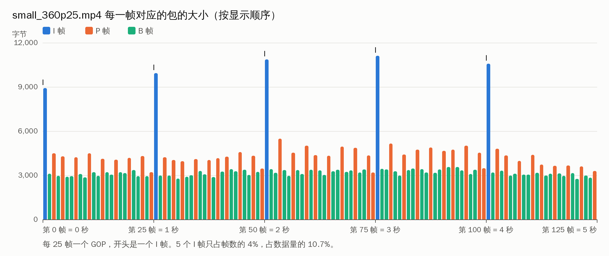
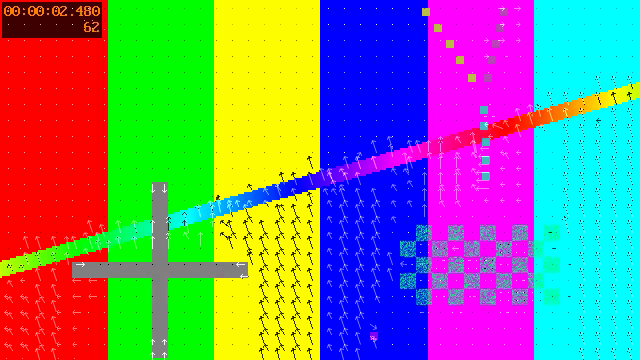

# L08 帧类型、GOP 与 side data

L07 把文件解成了图像和声音。这一讲回到视频帧本身，看 `AVFrame` 里除了图像之外还带着什么：
这一帧是 I 帧、P 帧还是 B 帧，是不是关键帧，以及解码器顺带交出来的额外信息（side data）。

这些信息决定了两件工程上天天遇到的事：**文件为什么不能从任意位置开始解码**，以及**想要某个时刻的画面，要多解多少帧**。
截图、拖动进度条、剪切，都绕不开它们。

完成标志：能用 `frame_info` 说出一个文件的 GOP 结构；`grab_frame` 截出的画面和 ffmpeg 命令行选出的同一帧逐字节相同；
能说清楚为什么截第 2.5 秒的画面要解 13 帧。

## 本讲要点

**三种帧类型**（`AVFrame.pict_type`，取值在 `libavutil/avutil.h` 的 `enum AVPictureType`）

| 类型 | 怎么压缩 | 解码时需要 | 大小 |
| --- | --- | --- | --- |
| I 帧 | 只用本帧内部的信息，相当于一张独立的图片 | 不需要别的帧 | 最大 |
| P 帧 | 记录“和前面的帧相比哪里变了” | 前面的参考帧 | 中等 |
| B 帧 | 前后两个方向都可以参考 | 前面和后面的参考帧 | 最小 |

B 帧要参考后面的帧，所以后面的帧必须先解出来。这就是 L04 见过的“dts 和 pts 顺序不同”的原因：
包按解码顺序（dts）存放，帧按显示顺序（pts）输出。

**关键帧和 GOP**

关键帧是可以作为解码起点的帧，用 `frame->flags & AV_FRAME_FLAG_KEY` 判断（包上对应的是 `AV_PKT_FLAG_KEY`，L04）。
从一个关键帧开始，到下一个关键帧之前，这一组帧叫一个 GOP（Group of Pictures）。

```text
显示顺序： I B P B P B B P … P │ I B P B P …
           └────── 一个 GOP ───┘ └── 下一个 GOP
```

关键帧一定是 I 帧，但 I 帧不一定是关键帧：H.264 里有的 I 帧后面的帧还会参考它前面的帧，从这种 I 帧开始解码会出错。
所以判断“能不能从这里开始”，要看关键帧标志，不要看 `pict_type`。

GOP 的长度是编码时定的，是一个取舍：

| | GOP 短（例如 1 秒） | GOP 长（例如 10 秒） |
| --- | --- | --- |
| 文件大小 | 大（I 帧多） | 小 |
| 拖动、截图 | 快，最多多解 1 秒的帧 | 慢，最多多解 10 秒的帧 |
| 直播中途加入 | 等待时间短 | 等待时间长 |

**side data：附在帧上的额外信息**（`libavutil/frame.h`）

`AVFrame.side_data` 是一个数组，每一项有类型（`enum AVFrameSideDataType`）、数据指针和大小。
常见的类型：

| 类型 | 内容 |
| --- | --- |
| `AV_FRAME_DATA_MOTION_VECTORS` | 运动矢量，要主动要求解码器导出 |
| `AV_FRAME_DATA_DISPLAYMATRIX` | 显示矩阵，播放时要旋转多少度 |
| `AV_FRAME_DATA_SEI_UNREGISTERED` | 码流里的自定义数据，例如编码器写的版本信息 |
| `AV_FRAME_DATA_A53_CC` | 隐藏字幕 |
| `AV_FRAME_DATA_MASTERING_DISPLAY_METADATA` | HDR 的显示参数 |

用到的函数：`av_frame_get_side_data(frame, 类型)` 按类型取一项，取不到返回 `NULL`；`av_frame_side_data_name()` 把类型变成名字。
side data 的内存归帧所有，`av_frame_unref()` 时一起释放，不要自己释放。

side data 有三个层次，不要混淆：

| 层次 | 在哪里 | 例子 |
| --- | --- | --- |
| 流 | `AVStream.codecpar->coded_side_data` | 容器记的旋转角度 |
| 包 | `AVPacket.side_data` | 中途更新的 extradata |
| 帧 | `AVFrame.side_data` | 运动矢量 |

**按时刻取一帧**

```text
            定位只能落在关键帧上          目标
                   ↓                      ↓
  … P B P │ I B P B P B B P B P B B P B [B] P …
            └── 这些帧都要解，但只用来解出目标帧 ──┘
```

1. `av_seek_frame(fmt, 流下标, 目标时间戳, AVSEEK_FLAG_BACKWARD)`：定位到目标**之前**最近的关键帧。
2. 从那里开始读包、解码，时间戳不到目标的帧丢掉。
3. 解到目标帧，输出，停下。

## 准备

```bash
scripts/gen_samples.sh                 # 已经生成过可以跳过
make -C L08_frame_types                # 可执行文件在 L08_frame_types/build/ 下
B=L08_frame_types/build
mkdir -p out
```

下面的命令都在仓库根目录执行。素材和 L07 相同：`samples/small_360p25.mp4` 是 640x360、25 帧每秒、5 秒的 H.264 视频。

| 程序 | 用途 |
| --- | --- |
| `extract_mvs` | 官方示例（加了课程注释）：把每一帧的运动矢量打印成 CSV |
| `frame_info` | 逐帧打印帧类型、关键帧、时间戳、包的大小、side data，最后给出统计 |
| `grab_frame` | 截出指定时刻的一帧，存成 PGM 灰度图 |

## 第 1 步：逐帧看帧类型

```bash
$B/frame_info samples/small_360p25.mp4 | head -9
```

```text
序号 类型 关键帧  时间戳                  包的大小      帧上的 side data
   0  I  关键帧  pts       0 =  0.000 秒    8912 字节  [H.26[45] User Data Unregistered SEI message，678 字节]
   1  B          pts     512 =  0.040 秒    3101 字节  -
   2  P          pts    1024 =  0.080 秒    4481 字节  -
   3  B          pts    1536 =  0.120 秒    2964 字节  -
   4  P          pts    2048 =  0.160 秒    4284 字节  -
   5  B          pts    2560 =  0.200 秒    2888 字节  -
   6  B          pts    3072 =  0.240 秒    2948 字节  -
   7  P          pts    3584 =  0.280 秒    4212 字节  -
```

帧是按显示顺序出来的，pts 每帧加 512（时间基 1/12800，一帧 0.04 秒）。再看包的顺序：

```bash
ffprobe -v error -select_streams v -show_entries packet=pts,dts,flags,size -of csv=p=0 samples/small_360p25.mp4 | head -4
```

```text
0,-1024,8912,K__
1024,-512,4481,___
512,0,3101,___
2048,512,4284,___
```

第二个包的 pts 是 1024、大小 4481，对应上面序号 2 的 P 帧；第三个包才是序号 1 的 B 帧。
P 帧在文件里排在 B 帧前面，因为 B 帧要参考它。解码器收下 P 帧先不输出，等 B 帧解完，再按显示顺序交出来。

最后的统计：

```bash
$B/frame_info samples/small_360p25.mp4 | tail -6
```

```text
共 125 帧
  I 帧   5 个，共   51403 字节，平均  10280 字节，占总数据量的 10.7%
  P 帧  46 个，共  196517 字节，平均   4272 字节，占总数据量的 40.8%
  B 帧  74 个，共  233685 字节，平均   3157 字节，占总数据量的 48.5%
GOP 共 5 个，长度（帧数）：25 25 25 25 25
流一级的 side data：无
```



5 个 GOP，每个 25 帧，正好 1 秒一个关键帧。I 帧平均是 B 帧的 3 倍多。
这个素材是彩条加移动的图形，画面简单，差距不算大；实拍的视频里 I 帧常常是 B 帧的十倍以上。

**包的大小是怎么对到帧上的。** `AVFrame` 里没有“这一帧压缩后多大”这个数，而帧和包的顺序又不一样，没法按先后对应。
`frame_info.c` 用的办法是让解码器帮忙带过去：

```c
dec->flags |= AV_CODEC_FLAG_COPY_OPAQUE;          /* 打开解码器之前 */
...
pkt->opaque = (void *)(intptr_t)pkt->size;        /* 送包之前，把大小放进 opaque */
...
const int size = (int)(intptr_t)frame->opaque;    /* 在解出的帧上取回来 */
```

设了 `AV_CODEC_FLAG_COPY_OPAQUE`，解码器会把每个包的 `opaque` 原样拷到它解出的那一帧上。
要给每一帧带一点自己的数据（序号、收到的时刻、来源），都可以用这个办法。

## 第 2 步：side data

第 1 步里序号 0 的帧带了一项 side data：`User Data Unregistered SEI`，678 字节。
这是 x264 编码器写在码流开头的一段文字，记着编码器版本和编码参数，可以这样看到：

```bash
strings samples/small_360p25.mp4 | grep -m1 -o "x264 - core [0-9]*"
```

```text
x264 - core 164
```

再看流一级的 side data。先用 ffmpeg 做一个带旋转标记的文件（只改容器里的标记，不重新编码）：

```bash
ffmpeg -v error -y -display_rotation:v:0 90 -i samples/small_360p25.mp4 -c copy out/rotated.mp4
$B/frame_info out/rotated.mp4 | sed -n '2,3p;$p'
```

```text
   0  I  关键帧  pts       0 =  0.000 秒    8912 字节  [3x3 displaymatrix，36 字节]  [H.26[45] User Data Unregistered SEI message，678 字节]
   1  B          pts     512 =  0.040 秒    3101 字节  [3x3 displaymatrix，36 字节]
  Display Matrix，36 字节，旋转 90 度
```

手机竖着拍的视频就是这样：图像数据仍然是横的，容器里记一个显示矩阵，告诉播放器显示时转 90 度。
这个矩阵记在流上（`codecpar->coded_side_data`），解码器又把它附到了每一帧上。
解码器**不会**替你旋转图像，自己写的截图、转码程序如果不处理这一项，竖拍的视频出来就是躺着的。
角度用 `av_display_rotation_get()`（`libavutil/display.h`）从矩阵算出来。

## 第 3 步：官方示例 extract_mvs.c

运动矢量是 P 帧、B 帧的核心：画面分成小块，每一块记下“我的内容是从参考帧的哪个位置搬过来的”。
解码器解码时本来就要用到这些矢量，`extract_mvs.c` 演示怎么让解码器把它们交出来。

```bash
$B/extract_mvs samples/small_360p25.mp4 2>/dev/null > out/mvs.csv
head -4 out/mvs.csv; wc -l < out/mvs.csv
```

```text
framenum,source,blockw,blockh,srcx,srcy,dstx,dsty,flags,motion_x,motion_y,motion_scale
2, 1,16,16,   8,   8,   8,   8,0x0,   0,   0,   4
2, 1,16,16,  24,   8,  24,   8,0x0,   0,   0,   4
2, 1,16,16,  40,   8,  40,   8,0x0,   0,   0,   4
174394
```

一行是一个矢量（`AVMotionVector`，`libavutil/motion_vector.h`）：

| 列 | 含义 |
| --- | --- |
| `framenum` | 第几帧，从 1 开始数（所以比 `frame_info` 的序号大 1） |
| `source` | 参考帧的方向：负数是过去的帧，正数是将来的帧 |
| `blockw`、`blockh` | 块的宽和高 |
| `srcx`、`srcy` | 这一块在参考帧里的位置（块的中心） |
| `dstx`、`dsty` | 这一块在当前帧里的位置 |
| `motion_x`、`motion_y`、`motion_scale` | 矢量本身，`src = dst + motion / motion_scale`。H.264 的精度是四分之一像素，所以 `motion_scale` 是 4 |

示例里和前几讲不同的只有两处，读代码时找 `课程注释`：

1. **要求导出**：打开解码器时传选项 `flags2=+export_mvs`。运动矢量默认不导出，因为整理它们要花时间。

   ```c
   av_dict_set(&opts, "flags2", "+export_mvs", 0);
   ret = avcodec_open2(dec_ctx, dec, &opts);
   ```

   `frame_info.c` 用的是另一种等价的写法：`dec->export_side_data |= AV_CODEC_EXPORT_DATA_MVS;`。

2. **取出来**：每解出一帧，按类型取 side data，里面是一个 `AVMotionVector` 数组。

   ```c
   sd = av_frame_get_side_data(frame, AV_FRAME_DATA_MOTION_VECTORS);
   if (sd) {
       const AVMotionVector *mvs = (const AVMotionVector *)sd->data;
       for (i = 0; i < sd->size / sizeof(*mvs); i++) {
   ```

   I 帧没有运动矢量，`av_frame_get_side_data()` 返回 `NULL`，所以一定要判断。

用 `frame_info` 加 `mvs` 参数看每帧有多少个矢量：

```bash
$B/frame_info samples/small_360p25.mp4 mvs | sed -n 2,4p
```

```text
   0  I  关键帧  pts       0 =  0.000 秒    8912 字节  [H.26[45] User Data Unregistered SEI message，678 字节]
   1  B          pts     512 =  0.040 秒    3101 字节  [Motion vectors，72880 字节，1822 个矢量]
   2  P          pts    1024 =  0.080 秒    4481 字节  [Motion vectors，38680 字节，967 个矢量]
```

B 帧的矢量大约是 P 帧的两倍，因为它两个方向都参考。ffmpeg 自带的 `codecview` 滤镜可以把矢量画在画面上：

```bash
ffmpeg -v error -y -flags2 +export_mvs -i samples/small_360p25.mp4 \
       -vf "codecview=mv=pf+bf+bb,select=eq(n\,62)" -frames:v 1 out/mv.png
```



箭头集中在移动的斜条和图形周围，静止的彩条上只有点（矢量为 0）。运动检测、视频稳定、粗略的目标跟踪都可以直接利用这些现成的矢量，不必自己再算一遍。

这个示例有 3 处问题，已做成 patch（见 `upstream_patches/` 的 0031 到 0033）：文件里没有视频流时退出码是 0；
打开解码器失败时泄漏解码器上下文；结果写不出去（例如磁盘满）时不报错。

## 第 4 步：截出指定时刻的一帧

```bash
$B/grab_frame samples/small_360p25.mp4 2.5 out/f.pgm
```

```text
目标：2.500 秒，时间戳 32000（时间基 1/12800）
定位之后解出的第一帧：pts 25600 = 2.000 秒，I 帧，关键帧
输出的帧：pts 31744 = 2.480 秒，B 帧，是定位之后解出的第 13 帧
送了 15 个包，解出 13 帧，其中 12 帧只是为了解出目标帧
```

要的是 2.5 秒，定位落在 2.0 秒的关键帧上，往后解了 13 帧才到目标。前 12 帧解出来就丢掉了，但不能不解：目标是 B 帧，它依赖前面这些帧。
输出的是 pts 2.480 秒的帧，因为这一帧从 2.48 秒显示到 2.52 秒，2.5 秒时屏幕上是它。`grab_frame.c` 里的判断是：

```c
if (frame->pts + frame->duration > g->target)     /* 这一帧的显示时间盖住了目标时刻 */
```

`out/f.pgm` 是一张灰度图（PGM 格式：一个文本头加 Y 平面的数据），用看图软件或 `ffplay out/f.pgm` 可以打开。
只存亮度是因为彩色图片要先把 YUV 转成 RGB，那是 L09 的内容。

验证截对了：让 ffmpeg 选出第 62 帧（从 0 数，62 × 0.04 = 2.48 秒）的 Y 平面，和我们文件里文本头之后的数据比较。

```bash
tail -c +16 out/f.pgm | md5sum
ffmpeg -v error -i samples/small_360p25.mp4 -vf "select=eq(n\,62),extractplanes=y" -frames:v 1 -f rawvideo - | md5sum
```

```text
2a497c36719d340ce291217d4c371455  -
2a497c36719d340ce291217d4c371455  -
```

**只要关键帧。** 很多场合不需要精确到帧，例如视频列表的封面、进度条上的预览图。加上 `key` 参数，直接输出定位到的那个关键帧：

```bash
$B/grab_frame samples/small_360p25.mp4 2.5 out/k.pgm key | tail -2
```

```text
输出的帧：pts 25600 = 2.000 秒，I 帧，是定位之后解出的第 1 帧
送了 3 个包，解出 1 帧，其中 0 帧只是为了解出目标帧
```

差了半秒，但只解了 1 帧。GOP 越长，两种做法的耗时差得越多，练习 4 用 1080p 的素材量一下。

**定位之后要不要清空解码器。** `grab_frame` 打开文件后只定位一次，解码器是空的，不需要清空。
如果解码中途再定位（播放器拖动进度条），解码器里还留着旧位置的参考帧和没输出的帧，必须先调用 `avcodec_flush_buffers()` 清掉，再送新位置的包，否则会输出旧画面或者花屏。
`grab_frame.c` 在重新定位的分支里就是这么做的。

## 第 5 步：定位不一定准

同样的内容换成 MPEG-TS 再试：

```bash
$B/grab_frame samples/small_360p25.ts 0.5 out/t.pgm 2>/dev/null
```

```text
目标：0.500 秒，时间戳 178200（时间基 1/90000）
定位之后解出的第一帧：pts 223200 = 2.480 秒，I 帧，关键帧
定位不到目标之前的关键帧，改为定位到时间戳 133200 再试
定位之后解出的第一帧：pts 223200 = 2.480 秒，I 帧，关键帧
定位不到目标之前的关键帧，改为从文件开头解码
定位之后解出的第一帧：pts 133200 = 1.480 秒，I 帧，关键帧
输出的帧：pts 176400 = 1.960 秒，B 帧，是定位之后解出的第 13 帧
送了 15 个包，解出 13 帧，其中 12 帧只是为了解出目标帧
```

（这个 TS 的时间戳从 1.48 秒开始，程序把“0.5 秒”理解成从开头算起 0.5 秒，所以目标是 1.98 秒，输出的帧 pts 是 1.960 秒。）

要的是开头附近，定位却落到了后面。原因在容器：MP4 有一张索引表，记着每个关键帧的位置，定位是查表，又快又准。
TS 没有索引，解封装器只能按码率估一个位置跳过去再找，文件短的时候尤其不准。

所以**定位之后一定要检查实际落在了哪里**，不能假设它听话。`grab_frame.c` 的处理是：解出的第一帧如果已经超过目标，就往前多退 2 秒重新定位；
还不行就回到文件开头从头解。这样慢一些，但结果总是对的。上面命令里 `2>/dev/null` 挡掉的是解码器的几行警告：
第一次落点之后的帧参考了更早的、没有解过的帧。那几帧我们没有用，重新定位时也清空了解码器。

超出视频长度时程序报错，退出码是 1：

```bash
$B/grab_frame samples/small_360p25.mp4 9 out/t.pgm; echo "退出码 $?"
```

```text
目标：9.000 秒，时间戳 115200（时间基 1/12800）
定位之后解出的第一帧：pts 51200 = 4.000 秒，I 帧，关键帧
9.000 秒超出了视频的长度
退出码 1
```

## 常见错误

1. **用 `pict_type == AV_PICTURE_TYPE_I` 判断能不能从这里开始解码。** 要看 `AV_FRAME_FLAG_KEY`（包上是 `AV_PKT_FLAG_KEY`）。I 帧不一定是关键帧。
2. **定位之后把解出的第一帧当成目标帧。** 定位只能落在关键帧上，目标帧通常在后面，要继续解码并比较时间戳。
3. **解码中途定位之后不调用 `avcodec_flush_buffers()`。** 解码器里残留的帧会混进新位置的输出里。
4. **定位时漏掉 `AVSEEK_FLAG_BACKWARD`。** 不加这个标志，可能落到目标**之后**的关键帧，目标帧就解不到了。
5. **假设定位一定落在目标之前。** 没有索引的格式（TS、裸流）定位是估算的。要检查解出的第一帧的时间戳，见第 5 步。
6. **把时间戳直接当成秒，或者忘了 `start_time`。** 目标时刻要用流的时间基换算成时间戳，再加上流的起始时间戳。
7. **不判断 `av_frame_get_side_data()` 的返回值。** 不是每一帧都有每一种 side data，I 帧就没有运动矢量。
8. **自己释放 side data，或者在 `av_frame_unref()` 之后继续用它的指针。** side data 的内存跟着帧走。
9. **忽略显示矩阵。** 竖拍的视频截图出来是躺着的。
10. **以为设置 `export_side_data` 没有代价。** 导出运动矢量会让解码变慢，只在需要时打开。

## 练习

1. 用 `frame_info` 看 `samples/demo_1080p30.mp4`：有几个 GOP，各多长？I、P、B 帧各有多少？为什么它的 I 帧只占数据量的 1% 多？
2. 用 `frame_info` 看 `samples/video_360p25.m1v`（MPEG-1 裸流）：有没有 B 帧？GOP 多长？I 帧占数据量的多少？流一级有什么 side data？
3. 用 `awk` 统计 `out/mvs.csv`：`source` 是负数和正数的矢量各有多少？`framenum` 是 3 的那一帧（P 帧）里有没有正数的？一共多少帧带运动矢量，为什么不是 125？
4. 用 `time` 比较 `$B/grab_frame samples/demo_1080p30.mp4 8 out/a.pgm` 加和不加 `key` 的耗时。各解了多少帧？加 `key` 时输出的是哪个时刻的帧，为什么差这么远？
5. 把 `grab_frame.c` 里两处 `av_seek_frame()` 的 `AVSEEK_FLAG_BACKWARD` 都改成 `0`，重新编译，再截 `small_360p25.mp4` 的 2.5 秒。定位落在哪里？程序最后截对了吗，靠的是什么？做完把代码改回去。

<details>
<summary>参考答案</summary>

1. 2 个 GOP，长度 250 和 50。I 帧 2 个，P 帧 123 个，B 帧 175 个。250 帧是 x264 默认的最大关键帧间隔，生成这个素材时没有另外指定。
   300 帧里只有 2 个 I 帧，所以只占 1.3%。代价在练习 4 里能看到。
2. 没有 B 帧（I 帧 11 个，P 帧 114 个）。GOP 长度是 12，最后一个是 5。I 帧占 23.2%，因为 GOP 短，I 帧多。流一级有一项 `CPB properties`（码率控制缓冲区的参数）。
3. `awk -F, 'NR>1{n[$2<0?"过去":"将来"]++} END{for(k in n)print k,n[k]}' out/mvs.csv`：过去 112,280 个，将来 62,113 个。
   第 3 帧只有负数（967 个），P 帧只参考过去的帧。带运动矢量的有 120 帧，另外 5 帧是 I 帧，没有运动矢量。
4. 不加 `key`：解了 241 帧，约 1.3 秒。加 `key`：解 1 帧，约 0.05 秒，但输出的是 0 秒的帧，离目标 8 秒。
   这个文件的关键帧在第 0 帧和第 250 帧（8.33 秒），8 秒之前最近的关键帧就是开头。GOP 长，文件小，但精确截图慢，按关键帧截图又不准。
5. 定位落在 3.000 秒的关键帧，在目标之后。程序发现第一帧已经超过目标，往前退 2 秒（0.5 秒处）重新定位，这次落在 1.000 秒的关键帧，在目标之前，最后仍然输出 2.480 秒的帧，文件和原来的逐字节相同。
   不过解了 38 帧，原来只要 13 帧。
   靠的是第 5 步讲的“检查实际落点”。只做定位、不检查的程序在这里会截错。

</details>

## 下一讲

`grab_frame` 只能存灰度图，因为解出来的是 YUV，而图片格式和屏幕要的是 RGB。
L09 学 libswscale：像素格式转换和缩放，例子是官方示例 `scale_video.c`，学完就能把截图存成彩色的。
