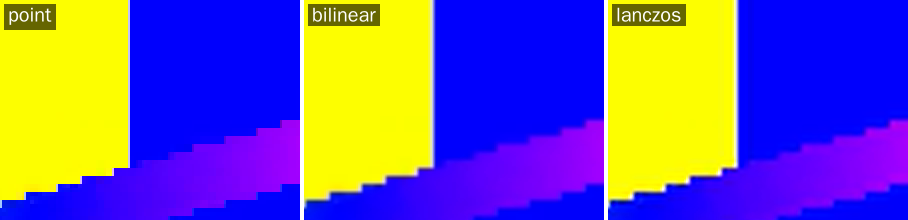
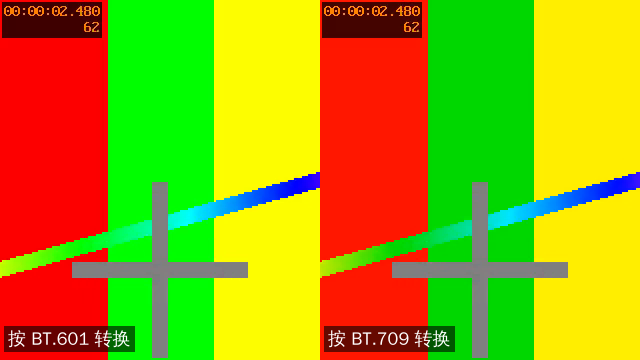

# L09 图像缩放与像素格式转换

L08 的截图是灰的，因为解码器给的是 YUV，而图片文件和屏幕要的是 RGB。
解码之后、显示或编码之前，几乎总要过一道转换：换像素格式，或者换尺寸，或者两样都换。
FFmpeg 里做这件事的库是 libswscale。

这一讲先弄清楚像素格式到底规定了什么，再用 libswscale 把截图变成彩色的，顺便生成缩略图。

完成标志：`grab_color` 截出的彩色图与 ffmpeg 命令行的结果逐字节相同；
能说出 yuv420p 和 nv12 的内存布局有什么不同；知道 BT.601 和 BT.709 用错了会怎样。

## 本讲要点

**像素格式规定了三件事**（`libavutil/pixfmt.h`、`libavutil/pixdesc.h`）

| 规定 | 例子 |
| --- | --- |
| 用哪些分量表示颜色 | Y、U、V，或者 R、G、B，可以再加透明度 A |
| 色度采样：色度的分辨率比亮度低多少 | 4:2:0 是宽高各一半，4:2:2 是宽一半，4:4:4 不降 |
| 分量在内存里怎么放 | planar（每个分量一个平面）还是 packed（交错放在一起），每个分量几位 |

常用的几种：

| 名字 | 布局 | 哪里会遇到 |
| --- | --- | --- |
| `yuv420p` | 3 个平面：Y、U、V，U 和 V 宽高各一半 | 绝大多数视频解码出来的格式 |
| `nv12` | 2 个平面：Y，以及 U、V 交错的一个平面 | 硬件解码器、摄像头 |
| `yuv420p10le` | 和 yuv420p 一样，每个分量 10 位，占 2 字节 | HDR 视频 |
| `rgb24`、`bgr24` | 1 个平面，每像素 3 字节 | 图片文件，OpenCV（用 bgr24） |
| `rgba`、`bgra` | 1 个平面，每像素 4 字节 | 显示、图形界面 |

**libswscale 一次调用做三件事**

```text
              ┌──────────── sws_scale_frame() ────────────┐
源帧 ───────→ │ 像素格式转换 ＋ 缩放 ＋ 色彩矩阵和范围的换算 │ ───────→ 目标帧
yuv420p       └───────────────────────────────────────────┘      rgb24
1920x1080                                                        320x180
```

推荐的写法（`libswscale/swscale.h`）：

| 步骤 | 函数 |
| --- | --- |
| 分配上下文 | `sws_alloc_context()`，然后设置 `ctx->scaler` 选缩放算法 |
| 说明要什么 | 在目标 `AVFrame` 上填 `format`、`width`、`height`（以及色彩属性） |
| 转换 | `sws_scale_frame(ctx, dst, src)`，目标帧的缓冲区由它分配 |
| 释放 | `av_frame_free()`、`sws_free_context()` |

**YUV 转 RGB 要知道两个色彩属性**

| 属性 | `AVFrame` 成员 | 含义 | 常见取值 |
| --- | --- | --- | --- |
| 色彩矩阵 | `colorspace` | Y、U、V 和 R、G、B 之间换算用的系数 | 标清 BT.601（`smpte170m`、`bt470bg`），高清 BT.709 |
| 范围 | `color_range` | 亮度用 16 到 235（有限范围）还是 0 到 255（全范围） | 视频几乎都是有限范围（`tv`），图片是全范围（`pc`） |

这两个属性应该记在文件里，由解码器填到帧上。很多文件没有记，值是 unspecified，这时要按约定猜。猜错了颜色会偏，见第 4 步。

**缩放算法**（`ctx->scaler`）

| 算法 | 特点 |
| --- | --- |
| `SWS_SCALE_POINT` | 取最近的一个点，最快，有锯齿 |
| `SWS_SCALE_BILINEAR` | 双线性，快，略模糊，适合实时和缩略图 |
| `SWS_SCALE_BICUBIC` | 双三次，较清晰，ffmpeg 命令行的默认值 |
| `SWS_SCALE_AREA` | 区域平均，缩小时效果好 |
| `SWS_SCALE_LANCZOS` | 最清晰，最慢 |

## 准备

```bash
scripts/gen_samples.sh                 # 已经生成过可以跳过
make -C L09_scale_video                # 可执行文件在 L09_scale_video/build/ 下
B=L09_scale_video/build
mkdir -p out
```

下面的命令都在仓库根目录执行。

| 程序 | 用途 |
| --- | --- |
| `scale_video` | 官方示例（加了课程注释）：自己画 100 帧图像，转成 RGB24 并缩放 |
| `pix_fmt_info` | 打印像素格式的内存布局 |
| `grab_color` | L08 `grab_frame` 的彩色版：截一帧，转成 RGB，可以缩放，存成 PPM |

## 第 1 步：像素格式的内存布局

```bash
$B/pix_fmt_info
```

```text
名字        平面 采样 每像素位 每分量位 640x360 一帧的字节数
yuv420p        3   4:2:0     12        8       345600
nv12           2   4:2:0     12        8       345600
yuv422p        3   4:2:2     16        8       460800
yuyv422        1   4:2:2     16        8       460800
yuv444p        3   4:4:4     24        8       691200
yuv420p10le    3   4:2:0     15       10       691200
gray           1   -          8        8       230400
rgb24          1   -         24        8       691200
bgr24          1   -         24        8       691200
rgba           1   -         32        8       921600
bgra           1   -         32        8       921600
```

同样是 640x360，yuv420p 一帧 345,600 字节，rgb24 是它的两倍。视频用 4:2:0 的原因就在这里：
人眼对颜色的细节不敏感，色度的分辨率降到四分之一，数据少了一半，几乎看不出来。

看两种格式的细节。它们的采样方式、总字节数都一样，区别只在怎么放：

```bash
$B/pix_fmt_info yuv420p
$B/pix_fmt_info nv12
```

```text
像素格式 yuv420p
  分量 3 个，平面 3 个，平均每像素 12 位
  色度采样：4:2:0（色度的宽是亮度的 1/2，高是亮度的 1/2）
  特点：planar（至少有两个分量各占一个平面） 
  分量 Y：在平面 0，起始偏移 0 字节，步长 1 字节，8 位
  分量 U：在平面 1，起始偏移 0 字节，步长 1 字节，8 位
  分量 V：在平面 2，起始偏移 0 字节，步长 1 字节，8 位
640x360 的一帧（不带填充）：
  平面 0：每行 640 字节，360 行，共 230400 字节
  平面 1：每行 320 字节，180 行，共 57600 字节
  平面 2：每行 320 字节，180 行，共 57600 字节
  合计 345600 字节
像素格式 nv12
  分量 3 个，平面 2 个，平均每像素 12 位
  色度采样：4:2:0（色度的宽是亮度的 1/2，高是亮度的 1/2）
  特点：planar（至少有两个分量各占一个平面） 
  分量 Y：在平面 0，起始偏移 0 字节，步长 1 字节，8 位
  分量 U：在平面 1，起始偏移 0 字节，步长 2 字节，8 位
  分量 V：在平面 1，起始偏移 1 字节，步长 2 字节，8 位
640x360 的一帧（不带填充）：
  平面 0：每行 640 字节，360 行，共 230400 字节
  平面 1：每行 640 字节，180 行，共 115200 字节
  合计 345600 字节
```

nv12 的 U 和 V 都在平面 1 里，U 从第 0 字节开始，V 从第 1 字节开始，步长都是 2，也就是 `UVUVUV…` 交错排列。
硬件解码器和摄像头喜欢给 nv12。把 nv12 的数据当成 yuv420p 来读，亮度是对的，颜色全错，这是接摄像头和硬件解码时的常见问题。

这些信息来自 `av_pix_fmt_desc_get()` 返回的 `AVPixFmtDescriptor`。写处理像素的代码时，
平面有几个、每个平面多大，都应该用 `libavutil/imgutils.h` 里的函数算（`av_image_fill_linesizes()`、`av_image_get_buffer_size()` 等），不要自己硬写 `宽 x 高 x 3 / 2`。

## 第 2 步：官方示例 scale_video.c

```bash
$B/scale_video out/scaled.rgb 640x480
ls -l out/scaled.rgb | awk '{print $5}'
```

```text
Scaling succeeded. Play the output file with the command:
ffplay -f rawvideo -pix_fmt rgb24 -video_size 640x480 out/scaled.rgb
92160000
```

它自己画 100 帧 320x240 的 YUV420P 图像，转成 RGB24 并放大到 640x480。输出是裸数据：640 × 480 × 3 × 100 = 92,160,000 字节。
没有图形界面时可以取一帧转成 PNG 来看：

```bash
ffmpeg -v error -y -f rawvideo -pix_fmt rgb24 -video_size 640x480 -i out/scaled.rgb -frames:v 1 out/scaled.png
```

读代码时找 `课程注释`。核心是三个调用：

```c
sws_ctx = sws_getContext(src_w, src_h, src_pix_fmt,       /* 源：宽、高、像素格式 */
                         dst_w, dst_h, dst_pix_fmt,       /* 目标：宽、高、像素格式 */
                         SWS_BILINEAR, NULL, NULL, NULL); /* 缩放算法 */
...
sws_scale(sws_ctx, (const uint8_t * const*)src_data, src_linesize,
          0, src_h, dst_data, dst_linesize);              /* 从第 0 行起处理 src_h 行 */
...
sws_freeContext(sws_ctx);
```

**这是旧式写法。** `libswscale/swscale.h` 把 `sws_getContext()` 和 `sws_scale()` 归在“Legacy (stateful) API”一节，
推荐的是 `sws_alloc_context()` 加 `sws_scale_frame()`。两种写法的对照：

| | 旧式（官方示例） | 推荐（`grab_color.c`） |
| --- | --- | --- |
| 图像放在哪里 | 4 个平面指针加 4 个 linesize 的数组，`av_image_alloc()` 分配 | `AVFrame` |
| 建立上下文 | `sws_getContext(源宽, 源高, 源格式, 目标宽, 目标高, 目标格式, …)` | `sws_alloc_context()` |
| 源或目标变了 | 要重新建上下文 | 不用管，每次按帧的属性处理 |
| 缩放算法 | 标志 `SWS_BILINEAR` | `ctx->scaler = SWS_SCALE_BILINEAR` |
| 色彩矩阵和范围 | 另外调用 `sws_setColorspaceDetails()` | 从帧的 `colorspace`、`color_range` 读 |
| 转换 | `sws_scale()` | `sws_scale_frame()` |
| 释放 | `sws_freeContext(ctx)` | `sws_free_context(&ctx)` |

旧接口没有被废弃，现有的项目和网上的资料里大量在用，所以要读得懂。新写的代码用推荐的写法：解码器给的就是 `AVFrame`，直接传进去，
色彩属性也不会漏。

这个示例有 4 处问题，已做成 patch（见 `upstream_patches/` 的 0034 到 0037）：建立上下文失败时释放了没有初始化的指针；
用法说明的句号印错了位置；不检查转换和写文件是否成功；以及把整个示例改成推荐的写法。

## 第 3 步：彩色截图和缩略图

```bash
$B/grab_color samples/small_360p25.mp4 2.5 out/f.ppm
```

```text
取到的帧：pts 31744 = 2.480 秒
源：640x360 yuv420p，色彩矩阵 unknown，范围 unknown
文件没有写明色彩矩阵，按高度 360 当作 smpte170m
目标：640x360 rgb24，转换用了 0.77 毫秒（含第一次调用时的初始化）
已写入 out/f.ppm
```

`out/f.ppm` 是彩色的了（PPM 格式：一个文本头加 RGB 数据，看图软件或 `ffplay out/f.ppm` 可以打开）。
取帧的部分和 L08 相同，新内容在 `convert_and_save()` 里，去掉打印之后只有这几行：

```c
sws = sws_alloc_context();
dst = av_frame_alloc();
sws->scaler = opt->scaler;                       /* 缩放算法 */

dst->format      = AV_PIX_FMT_RGB24;             /* 在目标帧上写明想要什么 */
dst->width       = opt->width  ? opt->width  : src->width;
dst->height      = opt->height ? opt->height : src->height;
dst->color_range = AVCOL_RANGE_JPEG;             /* RGB 图片用全范围 */

ret = sws_scale_frame(sws, dst, src);            /* 目标帧的缓冲区由它分配 */
```

存盘时要注意 `linesize`（L05）：RGB24 一行的有效数据是 `宽 x 3` 字节，`dst->linesize[0]` 可能比它大，所以 `write_ppm()` 是一行一行写的。

验证：让 ffmpeg 选出同一帧，用同样的算法和色彩矩阵转成 rgb24，与我们文件里文本头之后的数据比较。

```bash
tail -c +16 out/f.ppm | md5sum
ffmpeg -v error -i samples/small_360p25.mp4 -vf "select=eq(n\,62),scale=flags=bilinear" -frames:v 1 -pix_fmt rgb24 -f rawvideo - | md5sum
```

```text
77724da095d885707421f71fc914e968  -
77724da095d885707421f71fc914e968  -
```

**缩略图。** 加上尺寸参数，转格式的同时缩小：

```bash
$B/grab_color samples/demo_1080p30.mp4 3 out/thumb.ppm 320x180
```

```text
取到的帧：pts 46080 = 3.000 秒
源：1920x1080 yuv420p，色彩矩阵 unknown，范围 unknown
文件没有写明色彩矩阵，按高度 1080 当作 bt709
目标：320x180 rgb24，转换用了 1.58 毫秒（含第一次调用时的初始化）
已写入 out/thumb.ppm
```

格式转换和缩放是一次调用完成的，不需要先转成 RGB 再缩小。
缩略图要保持宽高比，目标尺寸得自己按比例算好（1920x1080 对应 320x180），libswscale 不管比例，给什么尺寸就拉伸成什么尺寸。

**缩放算法的差别。** 把 640x360 放大 4 倍，取同一块区域对比：

```bash
for a in point bilinear lanczos; do $B/grab_color samples/small_360p25.mp4 2.5 out/x4_$a.ppm 2560x1440 $a | grep 转换; done
```



`point` 的边缘是一格一格的，`bilinear` 把边缘抹平了但发虚，`lanczos` 边缘更利落。代价是时间。把 1080p 缩小到 320x180，一帧的转换时间（本机实测，含初始化，每次运行略有出入）：

| 算法 | point | area | bilinear | bicubic | lanczos |
| --- | --- | --- | --- | --- | --- |
| 毫秒 | 0.8 | 1.1 | 1.5 | 2.4 | 3.8 |

做缩略图、实时预览用 `bilinear` 或 `area` 就够了；离线转码追求画质时用 `bicubic` 或 `lanczos`。

## 第 4 步：色彩矩阵用错了会怎样

第 3 步的输出里有一行“文件没有写明色彩矩阵，按高度……当作……”。这一步看它为什么重要。

同一帧 YUV 数据，分别按 BT.601 和 BT.709 的系数转成 RGB：



右边的红色偏橙、绿色偏暗。两张图里至少有一张的颜色是错的，哪张对，取决于编码时用的是哪组系数。
现实中的症状是“转码之后颜色有点不对”“截图比播放器里看到的偏红”，很难一眼看出来，但放在一起比就很明显。

规则是这样的：

1. 文件里写了色彩矩阵，解码器会填到 `frame->colorspace`，`sws_scale_frame()` 自动使用，不用管。
2. 文件里没写（`AVCOL_SPC_UNSPECIFIED`），libswscale 默认当作 BT.601。这对高清视频通常是错的。
3. 所以 `grab_color.c` 在转换之前补了一步：没写的时候，高度不小于 720 当作 BT.709，否则当作 BT.601。播放器基本都按这个约定处理。

可以验证我们的缩略图和 ffmpeg 指定 BT.709 时的结果相同，而 ffmpeg 不指定时（按 BT.601）结果不同：

```bash
tail -c +16 out/thumb.ppm | md5sum
ffmpeg -v error -i samples/demo_1080p30.mp4 -vf "select=eq(n\,90),scale=320:180:flags=bilinear:in_color_matrix=bt709" -frames:v 1 -pix_fmt rgb24 -f rawvideo - | md5sum
ffmpeg -v error -i samples/demo_1080p30.mp4 -vf "select=eq(n\,90),scale=320:180:flags=bilinear" -frames:v 1 -pix_fmt rgb24 -f rawvideo - | md5sum
```

```text
074f2873f701745e7e1cff7ceaf81262  -
074f2873f701745e7e1cff7ceaf81262  -
9fb5616cdcbfa853ef58da3366e498cb  -
```

**范围**是同样的道理。视频的亮度一般只用 16 到 235，图片用 0 到 255。转换时要把 16 拉到 0、235 拉到 255，所以 `grab_color.c` 把目标帧设成全范围。
范围弄错的症状是画面发灰（该拉伸没拉伸），或者暗部和亮部的细节丢失（拉伸了两次）。

自己生成视频文件时，应该把色彩属性写进文件，别让下游去猜。这在 L13 讲编码时再说。

## 常见错误

1. **假设 `linesize` 等于 `宽 x 每像素字节数`。** 目标帧的每一行可能有填充，存盘、拷贝都要一行一行来。
2. **自己硬算缓冲区大小。** `宽 x 高 x 3 / 2` 只对 8 位的 4:2:0 成立。用 `av_image_get_buffer_size()`，或者干脆用 `AVFrame` 让库去分配。
3. **把 nv12 当成 yuv420p 读**（或者反过来）。总字节数相同，不会崩溃，但颜色全错。处理之前先看 `frame->format`。
4. **忽略色彩矩阵。** 高清视频没写矩阵时，默认按 BT.601 转，颜色偏。见第 4 步。
5. **范围处理了两次或者没处理。** 画面发灰或者对比度过强。
6. **用旧接口时，源的尺寸或格式变了还用原来的上下文。** `sws_getContext()` 建的上下文只认一种组合。码流中途换分辨率时会花屏或者崩溃。用 `sws_scale_frame()` 没有这个问题。
7. **缩放时不管宽高比。** libswscale 给什么尺寸就拉伸成什么尺寸，目标尺寸要自己按比例算。
8. **先转格式再缩放，分两次调用。** 一次调用可以同时完成，分两次更慢，画质也更差。
9. **每一帧都新建和释放上下文。** 上下文应该建一次，反复用；`sws_scale_frame()` 只在帧的属性变了时才重新初始化。
10. **混用两套释放函数的写法。** 旧的是 `sws_freeContext(ctx)`，新的是 `sws_free_context(&ctx)`（传指针的地址，释放后置空）。

## 练习

1. 用 `pix_fmt_info` 看 `yuv422p10le` 在 1920x1080 时的布局。一帧多少字节？是同尺寸 yuv420p 的几倍？各差在哪里？
2. 运行 `$B/scale_video out/small.rgb 160x120`。不看文件，先算出它应该有多少字节，再用 `ls -l` 核对。
3. 把 `demo_1080p30.mp4` 第 3 秒的画面分别用 `point` 和 `lanczos` 缩小到 320x180，比较两者的转换时间。两张图逐字节相同吗？
4. 把 `grab_color.c` 里按高度猜色彩矩阵的那一句改成固定用 `AVCOL_SPC_SMPTE170M`，重新编译，再生成第 3 步的缩略图。它和原来的 `out/thumb.ppm` 相同吗？它的 md5 和第 4 步的哪一条 ffmpeg 命令一致？做完把代码改回去。
5. 把 `grab_color.c` 的目标格式改成 `AV_PIX_FMT_GRAY8`（文件头改成 `P5`，每行写 `宽` 个字节），截 `small_360p25.mp4` 的 2.5 秒。
   它和 L08 `grab_frame` 截出的 `f.pgm` 相同吗？用 `od -An -tu1 -j16 -N8` 看两个文件的前 8 个像素，解释差别。做完把代码改回去。

<details>
<summary>参考答案</summary>

1. 8,294,400 字节，是 yuv420p（3,110,400 字节）的约 2.67 倍。两处差别：每个分量 10 位要占 2 个字节，翻一倍；
   4:2:2 的色度平面高度不减半，两个色度平面各 1920 字节 × 1080 行，比 4:2:0 多一倍。
2. 160 × 120 × 3 × 100 = 5,760,000 字节。
3. 不相同。本机上 `point` 不到 1 毫秒，`lanczos` 约 3.5 到 4 毫秒。`point` 每个输出像素只取一个源像素，1080p 缩到 180p 时大部分像素被直接丢掉，细线条会断；`lanczos` 用周围很多像素加权计算。
4. 不相同。改完之后的 md5 是 `9fb5616c…`，和第 4 步最后一条（ffmpeg 不指定矩阵）一致，说明 ffmpeg 的 scale 滤镜在文件没写矩阵时按 BT.601 处理。
5. 不相同。前 8 个像素，`f.pgm` 是 `83 82 82 82 82 82 83 83`，新文件是 `78 77 77 77 77 77 78 78`。
   L08 是把 Y 平面原样写出去的，是有限范围（16 到 235）的值；这里目标帧设了全范围，libswscale 做了拉伸：(83 − 16) × 255 / 219 ≈ 78。

</details>

## 下一讲

图像的转换讲完了，声音也有同样的问题：采样格式、采样率、声道布局不合要求时怎么转。
L10 学 libswresample，例子是官方示例 `resample_audio.c`，L06 留下的“通用的音频格式转换”在那里解决。
