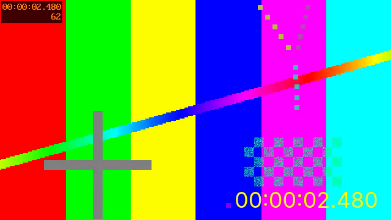
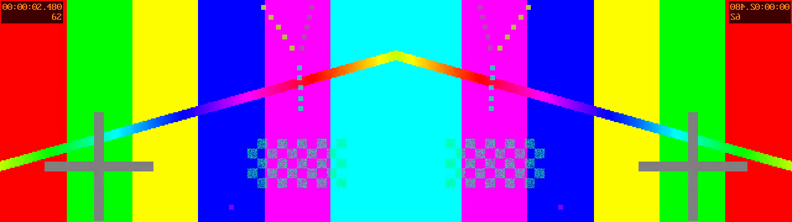

# L12 解码 + 滤镜

L11 手工搭了一张四个滤镜的图：一个个找滤镜、建实例、初始化，再一条条连接，写了几十行。
ffmpeg 命令行里同样的事只要一个字符串：`-af volume=0.5,aformat=sample_fmts=s16`。
这一讲学怎么在程序里用这样的字符串建图，并把滤镜图用到视频上。

到这里，“读文件、解码、处理”的完整流程就走通了：L04 的解复用、L07 的解码、L11 的滤镜图接在一起。
这也是 ffmpeg 命令行工具处理每一路流的方式。

完成标志：`filter_video` 对任意一个滤镜图描述的输出与 `ffmpeg -vf` 的结果逐字节相同；
能读懂并写出带分支的滤镜图描述；能说出官方示例为什么会少两帧。

## 本讲要点

**滤镜图描述的语法**（和 ffmpeg 命令行的 `-vf`、`-af`、`-filter_complex` 相同）

| 写法 | 意思 | 例子 |
| --- | --- | --- |
| `名字=参数` | 一个滤镜和它的参数 | `scale=320:180` |
| 参数之间用 `:` | 多个参数。可以按位置写，也可以写 `键=值` | `scale=320:180` 等于 `scale=w=320:h=180` |
| 滤镜之间用 `,` | 串成一条链，前一个的输出接后一个的输入 | `scale=320:180,hflip` |
| `[名字]` | 给一个口起名字，写在滤镜前面是它的输入，写在后面是它的输出 | `split[a][b]` |
| 链之间用 `;` | 分开几条链，链和链靠名字相接 | `split[a][b];[b]hflip[c];[a][c]hstack` |
| `[in]`、`[out]` | 整个描述的输入和输出。开头、结尾不写名字时默认就是它们 | `[in]scale=320:180[out]` |

参数里要用到 `:`、`,`、`;` 这些有特殊含义的字符时，要用 `\` 转义或者用单引号括起来，见第 4 步的 drawtext。

**用字符串建图**

```c
avfilter_graph_parse_ptr(graph, "scale=320:180,hflip", &inputs, &outputs, NULL);
```

这一个函数完成了 L11 里的“找滤镜、建实例、初始化、连接”。入口和出口滤镜仍然由程序自己建（它们的参数来自程序，不来自描述），
然后通过 `inputs`、`outputs` 两个 `AVFilterInOut` 告诉解析器：描述的那段图，两头分别接到哪里。

```text
 程序建的             字符串描述的那一段             程序建的
┌────────┐  [in]  ┌───────┐    ┌───────┐  [out]  ┌────────────┐
│ buffer │ ─────> │ scale │ ─> │ hflip │ ──────> │ buffersink │
└────────┘        └───────┘    └───────┘         └────────────┘
 outputs 指向它的输出口                             inputs 指向它的输入口
```

`outputs`、`inputs` 的名字是站在“字符串描述的那一段”的角度起的，第一次看很容易看反：
`outputs` 是**已有滤镜空着的输出口**，要接到描述的输入 `[in]`；`inputs` 是**已有滤镜空着的输入口**，要接到描述的输出 `[out]`。

**视频滤镜图和音频的区别**

| | 音频（L11） | 视频 |
| --- | --- | --- |
| 入口、出口滤镜 | `abuffer`、`abuffersink` | `buffer`、`buffersink` |
| 入口要知道的参数 | 采样格式、采样率、声道布局、时间基 | 像素格式、宽、高、时间基，最好还有帧率、像素宽高比、色彩矩阵和范围 |
| 自动插入的转换 | `aresample` | `scale` |
| 限定出口格式 | `aformat` 滤镜，或出口的 `sample_formats` 等选项 | `format` 滤镜，或出口的 `pixel_formats` 选项 |

**滤镜会改变什么**

出口拿到的帧不一定和送进去的一样多、一样大、一样的时间基：

- `scale`、`crop`、`hstack` 改尺寸；`format` 改像素格式；
- `fps` 改帧数和时间基；`reverse` 要等输入全部结束才开始输出。

所以输出的尺寸、帧率、时间基都要在配置之后问出口（`av_buffersink_get_w()` 等），帧数以实际取到的为准。

**完整的结束流程**

```text
文件读完 → 给解码器送空包，取完它剩下的帧，照常送进图 → 给图的入口送 NULL → 从出口取到 AVERROR_EOF
```

L10 说的“从上游到下游依次冲刷”，现在是三个环节：解复用器、解码器、滤镜图。

## 准备

```bash
scripts/gen_samples.sh                 # 已经生成过可以跳过
make -C L12_decode_filter              # 可执行文件在 L12_decode_filter/build/ 下
B=L12_decode_filter/build
mkdir -p out
```

下面的命令都在仓库根目录执行。

| 程序 | 用途 |
| --- | --- |
| `decode_filter_video` | 官方示例（加了课程注释）：解码视频，缩小、旋转、转灰度，用字符在终端里播放 |
| `decode_filter_audio` | 官方示例（加了课程注释）：解码音频，转成 8000 Hz 单声道 s16，写到标准输出 |
| `filter_video` | 解码视频，经过命令行给的滤镜图，写成 Y4M 文件 |

## 第 1 步：官方示例 decode_filter_video.c

```bash
$B/decode_filter_video samples/small_360p25.mp4
```

它在终端里用字符把视频“放”了一遍（约 5 秒），最后一帧的开头几行是这样的：

```text
++++++++++++++++++++++++
++++++++++++++++++++++++
++++++++++++++++++++++++
```

运行时先打印了两行 `Changing video frame properties on the fly is not supported by all filters.` 之类的警告，
原因是它建入口滤镜时没有把色度位置等属性说全（patch 0007），不影响运行。

滤镜图的描述是源码开头的一个字符串：

```c
const char *filter_descr = "scale=78:24,transpose=cclock";
```

缩小到 78x24，再逆时针转 90 度，得到 24 列、78 行的画面（终端里一个字符的高度大约是宽度的两倍，所以要转一下才不变形）。
出口滤镜被限定为只接受 gray8，于是每个像素只有一个亮度值，程序用 `" .-+#"` 五个字符之一来代表。

读代码时找 `课程注释`。`init_filters()` 的结构是：

```c
/* 1. 自己建入口 buffer，参数拼成字符串 */
avfilter_graph_create_filter(&buffersrc_ctx, buffersrc, "in", args, NULL, filter_graph);

/* 2. 自己建出口 buffersink，限定像素格式 */
buffersink_ctx = avfilter_graph_alloc_filter(filter_graph, buffersink, "out");
av_opt_set(buffersink_ctx, "pixel_formats", "gray8", AV_OPT_SEARCH_CHILDREN);
avfilter_init_dict(buffersink_ctx, NULL);

/* 3. 说明描述的两头接到哪里 */
outputs->name = av_strdup("in");   outputs->filter_ctx = buffersrc_ctx;   ...
inputs->name  = av_strdup("out");  inputs->filter_ctx  = buffersink_ctx;  ...

/* 4. 解析描述，5. 配置 */
avfilter_graph_parse_ptr(filter_graph, filters_descr, &inputs, &outputs, NULL);
avfilter_graph_config(filter_graph, NULL);
```

主循环把 L07 的解码循环和 L11 的送帧、取帧循环套在一起：读包，送解码器，取帧，送进图，从图里取帧，显示。

**它少显示了两帧。** 示例每显示一帧先输出一个清屏的控制序列（`ESC c`），数它的个数就是显示的帧数：

```bash
$B/decode_filter_video samples/small_360p25.mp4 2>/dev/null | grep -c $'\033c'
```

```text
123
```

素材有 125 帧。原因在主循环的结尾：`av_read_frame()` 返回文件结束之后，示例直接去结束滤镜图，**没有先冲刷解码器**。
解码器因为 B 帧重排（L08）还留着两帧，就这样丢了。它记得冲刷滤镜图，却忘了上游还有一个解码器。

这个示例和下面的音频示例一共有 5 处问题，已做成 patch（见 `upstream_patches/` 的 0048 到 0052）。

## 第 2 步：filter_video，用命令行给的描述处理视频

```bash
$B/filter_video samples/small_360p25.mp4 out/small.y4m "scale=320:-2"
```

```text
图里的连接（上游 -> 下游：这条连接上的格式）：
  in -> Parsed_scale_0：640x360，yuv420p
  Parsed_scale_0 -> out：320x180，yuv420p
出口 buffersink：320x180，yuv420p，帧率 25/1，时间基 1/12800
送进 125 帧，取出 125 帧，其中冲刷滤镜图时取出 0 帧
写出 out/small.y4m
```

`scale=320:-2` 的意思是宽 320，高按比例算并取成偶数。解析器给描述里的滤镜实例起的名字是 `Parsed_滤镜名_序号`。
125 帧一帧不少。

输出是 Y4M 文件：开头一行文本写明宽、高、帧率，后面每帧是一行 `FRAME` 加 yuv420p 的数据。ffplay 可以直接播放，不用像 L05 的裸 YUV 那样手工指定尺寸：

```bash
head -c 60 out/small.y4m | head -1
ffplay out/small.y4m          # 有图形界面时
```

```text
YUV4MPEG2 W320 H180 F25:1 Ip A1:1 C420mpeg2
```

`filter_video.c` 和官方示例有四处不同：

**入口的参数用结构体传。** 不用把像素格式的枚举值拼进字符串，色彩属性和帧率也都传到了：

```c
par->format              = frame->format;
par->width               = frame->width;
par->height              = frame->height;
par->sample_aspect_ratio = frame->sample_aspect_ratio;
par->color_space         = frame->colorspace;
par->color_range         = frame->color_range;
par->alpha_mode          = frame->alpha_mode;
par->chroma_location     = frame->chroma_location;
par->time_base           = time_base;       /* 流的时间基 */
par->frame_rate          = frame_rate;      /* av_guess_frame_rate() 的结果 */
ret = av_buffersrc_parameters_set(c->src, par);
```

**先冲刷解码器，再结束滤镜图。** 文件读完之后：

```c
ret = decode(dec, NULL, frame, &c, stream, frame_rate);   /* 空包：解码器吐出剩下的帧，照常送进图 */
...
ret = av_buffersrc_add_frame(c.src, NULL);                /* 然后才告诉图：输入结束了 */
ret = drain(&c);                                          /* 取到 AVERROR_EOF */
```

**输出的尺寸和帧率问出口。** 写 Y4M 头时用的是 `av_buffersink_get_w()`、`av_buffersink_get_h()`、`av_buffersink_get_frame_rate()`，不是输入的宽高。

**出错就停。** 送帧失败时返回错误，不继续往下跑。

验证：把 Y4M 里的画面数据和 ffmpeg 用同一个描述处理的结果比较。

```bash
ffmpeg -v error -i out/small.y4m -f rawvideo - | md5sum
ffmpeg -v error -i samples/small_360p25.mp4 -an -vf "scale=320:-2,format=yuv420p" -f rawvideo - | md5sum
```

```text
7e1984840af99d198cde5d402f97ee64  -
7e1984840af99d198cde5d402f97ee64  -
```

## 第 3 步：换几个描述

程序不用改，换第三个参数就是另一种处理。

**裁剪加镜像。** 从 (160, 0) 开始裁出 320x360 的一块，再左右翻转：

```bash
$B/filter_video samples/small_360p25.mp4 out/flip.y4m "crop=320:360:160:0,hflip" | sed -n 2,5p
```

```text
  in -> Parsed_crop_0：640x360，yuv420p
  Parsed_crop_0 -> Parsed_hflip_1：320x360，yuv420p
  Parsed_hflip_1 -> out：320x360，yuv420p
出口 buffersink：320x360，yuv420p，帧率 25/1，时间基 1/12800
```

**改帧率。** 每秒只留 5 帧：

```bash
$B/filter_video samples/small_360p25.mp4 out/fps5.y4m "fps=5" | tail -3
```

```text
出口 buffersink：640x360，yuv420p，帧率 5/1，时间基 1/5
送进 125 帧，取出 25 帧，其中冲刷滤镜图时取出 0 帧
写出 out/fps5.y4m
```

送进 125 帧，取出 25 帧。出口的帧率变成了 5，时间基也从 1/12800 变成了 1/5。
这就是为什么送帧和取帧是两个独立的循环，以及为什么输出的参数要问出口。

## 第 4 步：在画面上写字

```bash
$B/filter_video samples/small_360p25.mp4 out/ts.y4m \
    "drawtext=text='%{pts\:hms}':fontsize=36:fontcolor=yellow:x=w-tw-20:y=h-th-20" | tail -2
```

```text
送进 125 帧，取出 125 帧，其中冲刷滤镜图时取出 0 帧
写出 out/ts.y4m
```



drawtext 把每一帧的时间戳画在右下角（素材左上角本来就有一个时间，可以对照）。这个描述里有三样值得看：

- `x=w-tw-20`：参数可以是表达式。`w`、`h` 是画面的宽高，`tw`、`th` 是文字的宽高。很多滤镜的参数都支持表达式。
- `%{pts\:hms}`：drawtext 自己的展开语法，取当前帧的时间。里面的冒号前面加了 `\`，因为冒号在描述里是参数的分隔符。
- 整个 `text` 的值用单引号括了起来，这样里面的 `%{...}` 不会被描述的解析器误解。

描述是字符串套字符串：外面有 shell 的引号，里面有滤镜图描述自己的引号和转义，写在 C 代码里还要再加一层。遇到“参数解析失败”先查这个。

（drawtext 需要 FFmpeg 编译时带 libfreetype，课程的编译脚本已经带上。它用系统的默认字体，没有装字体时会报错，可以加 `fontfile=字体文件路径`。）

## 第 5 步：有分支的图

前面的描述都是一条链。用名字和分号可以写出分叉、合并的图。把画面复制成两份，一份翻转，再左右拼起来：

```bash
$B/filter_video samples/small_360p25.mp4 out/side.y4m "split[a][b];[b]hflip[c];[a][c]hstack" | head -7
```

```text
图里的连接（上游 -> 下游：这条连接上的格式）：
  in -> Parsed_split_0：640x360，yuv420p
  Parsed_split_0 -> Parsed_hstack_2：640x360，yuv420p
  Parsed_split_0 -> Parsed_hflip_1：640x360，yuv420p
  Parsed_hflip_1 -> Parsed_hstack_2：640x360，yuv420p
  Parsed_hstack_2 -> out：1280x360，yuv420p
出口 buffersink：1280x360，yuv420p，帧率 25/1，时间基 1/12800
```



描述分三段读：

```text
split[a][b]       输入（默认的 [in]）复制成两份，分别叫 a 和 b
[b]hflip[c]       b 左右翻转，结果叫 c
[a][c]hstack      a 和 c 左右拼接，输出（默认的 [out]）
```

图是这样的：

```text
                ┌───────────── a ─────────────┐
 in ─> split ──┤                              ├─> hstack ─> out
                └── b ──> hflip ──── c ───────┘
```

程序一行没改。入口还是一个，出口还是一个，中间怎么分叉、怎么合并，全在描述里。

每个起了名字的口都必须接上。少接一个，配置时报错：

```bash
$B/filter_video samples/small_360p25.mp4 out/x.y4m "split[a][b];[a]null"
```

```text
Output pad "output1" with type video of the filter instance "Parsed_split_0" of split not connected to any destination
配置滤镜图失败：Invalid argument
```

## 第 6 步：结束时图里还有帧

```bash
$B/filter_video samples/small_360p25.mp4 out/rev.y4m "reverse" | tail -2
```

```text
送进 125 帧，取出 125 帧，其中冲刷滤镜图时取出 125 帧
写出 out/rev.y4m
```

reverse 把视频倒过来放。它必须等到最后一帧才知道第一帧该输出什么，所以前面一帧都不输出，全部 125 帧都是在送了 `NULL` 之后才出来的。
如果程序不冲刷滤镜图，这个文件就是空的。L11 里不冲刷只少十几个采样，这里是全部。

（reverse 把所有帧都存在内存里，只适合很短的片段。）

## 第 7 步：官方示例 decode_filter_audio.c

```bash
$B/decode_filter_audio samples/small_360p25.mp4 2>/dev/null | wc -c
```

```text
80000
```

它和视频示例是同一个结构，描述是 `aresample=8000,aformat=sample_fmts=s16:channel_layouts=mono`，结果写到标准输出。
5 秒、8000 Hz、单声道、16 位，正好 80,000 字节。播放：

```bash
$B/decode_filter_audio samples/small_360p25.mp4 | ffplay -f s16le -ar 8000 -ch_layout mono -
```

注意：示例的用法里提示的命令写的是 `-ac 1`，ffplay 已经没有这个选项，照着敲会报 `Option not found`（patch 0051）。

用 L10 做的 `out/change.aac`（参数中途变化的文件）可以看到它的另一个问题：

```bash
$B/decode_filter_audio out/change.aac 2>&1 >/dev/null | grep -c "Error while feeding"
$B/decode_filter_audio out/change.aac >/dev/null 2>&1; echo "退出码 $?"
```

```text
23
退出码 0
```

送帧失败之后它没有停，对后面的 23 帧各报了一次同样的错，最后还报告成功（patch 0049）。出错后继续运行并返回 0，是脚本里最难查的一类问题。

## 第 8 步：视频的格式协商

官方的视频示例要 gray8，解码出来的是 yuv420p，转换是谁做的？用 `filter_video` 看一个类似的描述，在末尾要求灰度：

```bash
$B/filter_video samples/small_360p25.mp4 out/gray.y4m "scale=78:24,transpose=cclock,format=gray" | head -6
```

```text
图里的连接（上游 -> 下游：这条连接上的格式）：
  in -> Parsed_scale_0：640x360，yuv420p
  Parsed_scale_0 -> Parsed_transpose_1：78x24，gray
  Parsed_transpose_1 -> Parsed_format_2：24x78，gray
  Parsed_format_2 -> auto_scale_0：24x78，gray
  auto_scale_0 -> out：24x78，yuv420p
```

两件事：

- `Parsed_scale_0` 的输出已经是 gray 了。描述里本来就有一个 scale，它既能缩放也能转像素格式，协商的结果是让它顺手把格式也转了，没有另外插入滤镜。
- 末尾多了一个 `auto_scale_0`，因为 `filter_video` 的出口只接受 yuv420p（Y4M 文件的要求），gray 要再转回去。这就是 L11 说的自动插入，视频插的是 scale。

所以官方示例里的转换是它描述里的那个 scale 完成的。

## 常见错误

1. **把 `inputs` 和 `outputs` 填反。** `outputs` 填入口滤镜、名字 `"in"`；`inputs` 填出口滤镜、名字 `"out"`。记法：它们描述的是已有滤镜**空着的**口。
2. **文件读完后不冲刷解码器就结束滤镜图。** 少最后几帧。官方示例就是这样（patch 0050）。
3. **入口参数和帧不一致，或者没说全。** 尺寸、像素格式错了会花屏或报错；色彩属性没传，后面做色彩转换的滤镜会按“未指定”处理。
4. **没有给帧设时间戳。** 很多滤镜（fps、drawtext 的时间、overlay 的同步）依赖 pts。送进图之前用 `best_effort_timestamp` 补上。
5. **假定输出和输入一样多、一样大。** fps 改帧数，scale 改尺寸。以出口为准。
6. **用输入流的时间基去解释输出帧的 pts。** 滤镜可能改时间基，要用 `av_buffersink_get_time_base()`。
7. **描述里的特殊字符没有转义。** 参数值里的 `:`、`,`、`;`、`[`、`]` 和引号都有含义。在 shell 里再套一层引号时尤其容易出错。
8. **起了名字的口没接上，或者同一个名字用了两次。** 配置时报 `not connected` 或解析时报错。
9. **送帧失败只打印不处理。** 后面每一帧都会失败。出错就停，并返回非 0 的退出码。
10. **`avfilter_inout_free()` 漏掉。** `avfilter_graph_parse_ptr()` 之后不管成功失败，两个 `AVFilterInOut` 都要释放。

## 练习

1. 写一个描述：宽度缩到原来的一半（高按比例取偶数），再上下翻转。先想输出尺寸是多少，再用 `filter_video` 运行核对。提示：`iw` 是输入的宽，上下翻转的滤镜叫 `vflip`。
2. 用 `fps=50` 处理 `small_360p25.mp4`。取出多少帧？其中冲刷时取出几帧？出口的时间基是多少？
3. 画中画：把缩小到 160 宽的画面叠在原画面的右上角（离边 10 像素）。提示：叠加的滤镜叫 `overlay`，两个输入依次是底图和小图，
   参数 `W-w-10:10` 是小图左上角的位置，`W` 是底图的宽，`w` 是小图的宽。写出描述并运行，看图里有哪些连接。
4. 用官方示例 `decode_filter_video` 处理 `samples/video_360p25.m1v`，数显示的帧数。为什么它只少 1 帧，而 MP4 少 2 帧？
5. 把 `filter_video.c` 的 `main()` 里冲刷滤镜图的那一段（从 `ret = av_buffersrc_add_frame(c.src, NULL);` 到 `drain()` 之后的两个检查）去掉，
   重新编译，分别用 `null`（什么都不做的滤镜）和 `reverse` 运行。各取出多少帧？做完把代码改回去。

<details>
<summary>参考答案</summary>

1. `scale=iw/2:-2,vflip`，输出 320x180。
2. 取出 250 帧，其中 2 帧是冲刷时取出的，出口的时间基是 1/50。fps 滤镜把每一帧重复一次来凑够 50 帧每秒；
   最后一帧要重复几次，要等知道输入结束了才能确定，所以留到冲刷时输出。
3. `split[a][b];[b]scale=160:-2[s];[a][s]overlay=W-w-10:10`。图里有 5 条连接：in 到 split，split 到 overlay（底图），split 到 scale，
   scale 到 overlay（小图，160x90），overlay 到 out。小图那条连接上的像素格式是 yuva420p（带透明通道），这是 overlay 对第二个输入的要求，协商时由 scale 顺手转了。
4. 显示 124 帧，少 1 帧。解码器为了把 B 帧排回显示顺序要留着几帧，留多少由码流决定：
   `ffprobe -v error -select_streams v -show_entries stream=has_b_frames -of csv=p=0 文件` 对 MPEG-1 素材输出 1，对 H.264 素材输出 2，正好是各自少的帧数。
5. `null`：取出 125 帧，一帧不少，因为 null 不留帧。`reverse`：取出 0 帧，输出文件里只有一行文件头。
   和 L11 的结论一样：不冲刷会不会丢东西取决于图里有什么滤镜，而图是用户给的，程序必须总是冲刷。

</details>

## 下一讲

到这里，课程的前半部分“把文件读进来、解开、处理”就完成了。从 L13 开始走另一半：把处理好的数据**编码**回去。
L13 学视频编码，例子是官方示例 `encode_video.c`，会讲到码率、GOP、编码预设这些编码参数，以及怎么用选项字典给编码器传参数。
